# 04 · Визуальный отчёт

[← Оглавление](README.md) · [Интерактивный отчёт](report.html)

Проблемы интерфейса со скриншотами. Полные описания — в [каталоге](03-issues-catalog.md).

Скриншоты сделаны в Chrome через Playwright на `prototype-v20.html` (тот же файл, что на feture-mvp.vercel.app). Кнопка «V20» в левом нижнем углу — инструмент прототипа, не продукт.

## Premium

### SET-013 · P2 — Оплата происходит сразу по нажатию «Подарить · …» — без экрана подтверждения, который есть у собственной…

Оплата происходит сразу по нажатию «Подарить · …» — без экрана подтверждения, который есть у собственной покупки (лист «Подтверждение» → «Оплатить»). Срок — выпадающий список «1 месяц» без цен, цена видна только на кнопке. Тост успеха: «… В прототипе деньги не списываются» — служебная фраза в продуктовом UI. Без получателя кнопка «Укажи получателя» серая (контраст 1,8:1) и не реагирует. Ник заблокированного (dan) даёт «Такого ника нет. Проверь написание» — хотя пользователь сам его заблокировал.

**Исправление:** ACT.giftPay (7831): открывать лист подтверждения (как ACT.bBuy 7778) и платить в нём; giftSheet (7817): вместо choices() — premPlans-подобные карточки с ценами; убрать «В прототипе деньги не списываются» из ok-тоста. Пустое состояние — кнопка активна и фокусирует поле ника с ошибкой «Укажи ник».

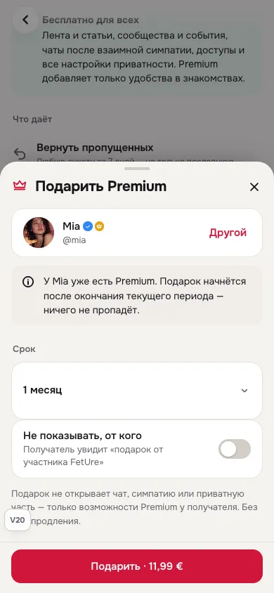

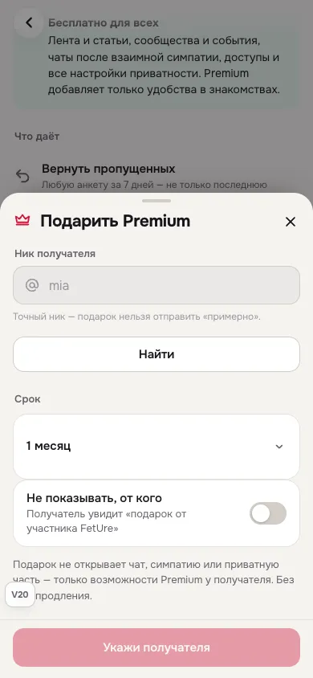

### SET-014 · P3 — Кнопка закрытия ✕ наезжает на правый верхний угол градиентной шапки (видно и на 390, и в модальном окне на…

Кнопка закрытия ✕ наезжает на правый верхний угол градиентной шапки (видно и на 390, и в модальном окне на 1440). Вторая функция «Вся история просмотров» показана без пояснения (в B01 у неё есть «Все просмотренные за неделю»). У листа нет заголовка/доступного имени (title:false → aria без имени). В тёмной теме белый текст кнопки «Оформить» на красном — 3,3:1.

**Исправление:** paywall (7764): .pw-x — top:12px; right:12px относительно .pw-sheet с отступом над .pw-hero (или внутри шапки с белым фоном 32px); premFeats — не скрывать <small> у неактивных (CSS .pw-f:not(.on) small); sheet(..., {label:"FetUre Premium"}).

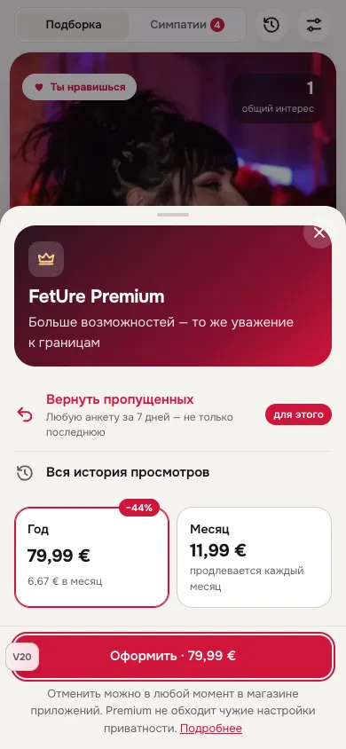

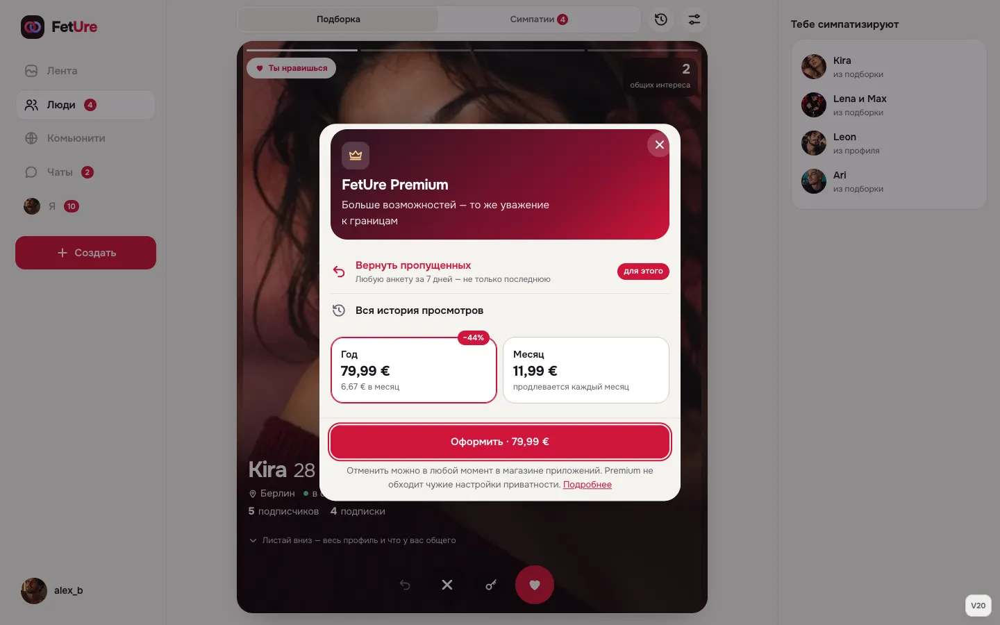

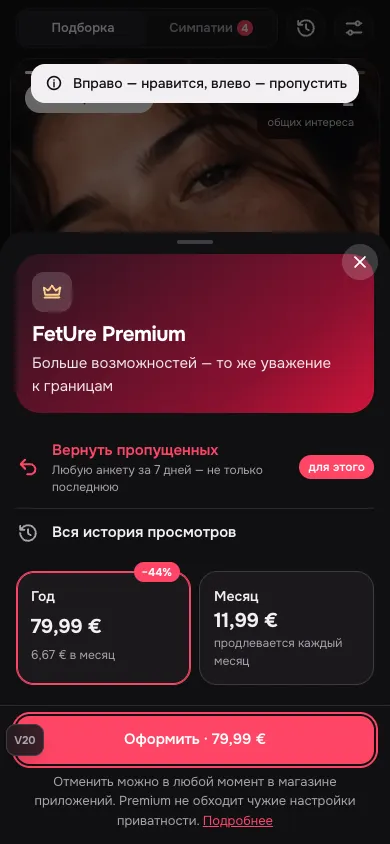

## «Я»

### VIS-003 · P2 — Красная точка «есть новое» стоит вплотную к следующей подписи («Профиль•Приватное•Видимость»), подписи почти…

Красная точка «есть новое» стоит вплотную к следующей подписи («Профиль•Приватное•Видимость»), подписи почти слипаются; «Приватное» обрезано на 8 px уже на 390 px (scrollWidth 82 > clientWidth 74), на 320 px шрифт падает до 12 px.

**Исправление:** Точку позиционировать абсолютно относительно `span` подписи: `.seg button .dot{position:absolute;top:6px;right:4px}` и зарезервировать `padding-right:10px` только у вкладки с точкой; убрать уменьшение шрифта до 12 px. Если не помещается на 320 px — режим прокрутки из VIS-002 или короткие подписи «Профиль / Доступ / Видимость / Моё».

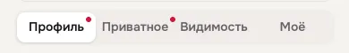

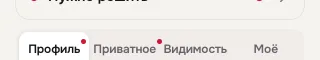

## Адаптивность (планшет/десктоп)

### RESP-001 · P2 — Себя пользователь видит дважды: пункт навигации «Я» с аватаром и бейджем, и внизу кнопка аккаунта «alex_b /…

Себя пользователь видит дважды: пункт навигации «Я» с аватаром и бейджем, и внизу кнопка аккаунта «alex_b / Личный профиль ˅» с тем же аватаром. На 768–1099 px — два одинаковых круглых аватара в рельсе.

**Исправление:** В `renderSide()` (prototype-v20.html:4005) для пункта «Я» использовать иконку `I.me` вместо аватара; бейдж оставить на пункте. В кнопке `.mebtn` разделить зоны: основная зона → `openMe("X01")`, шеврон → `openActorPopover`. Для персоны без пары шеврон скрыть.

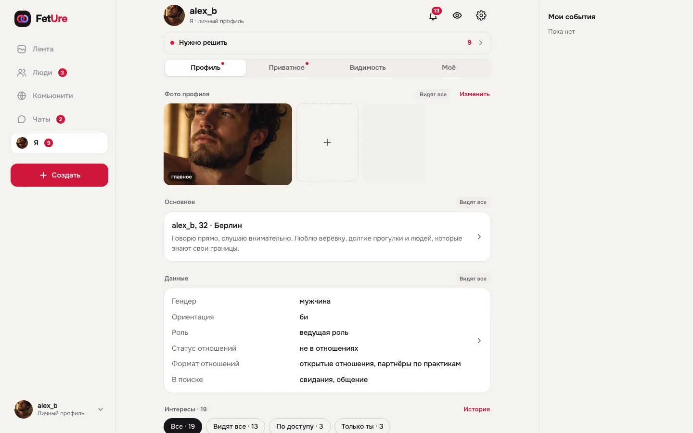

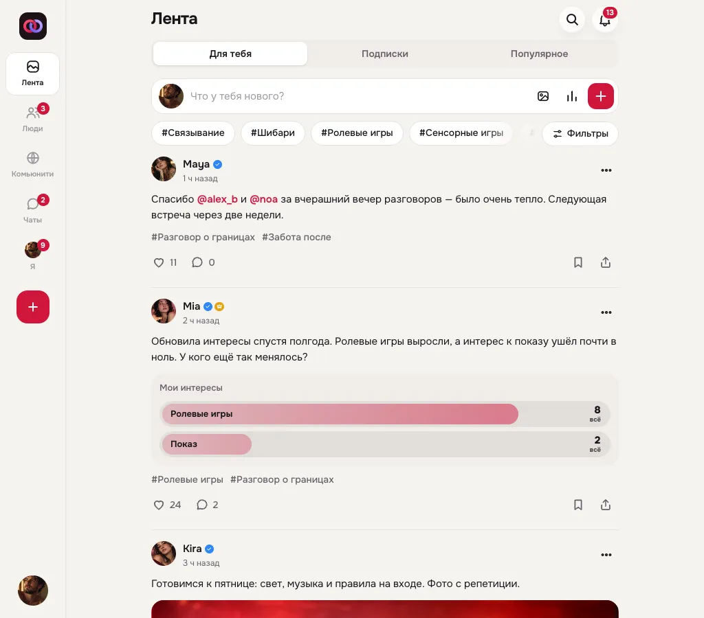

## Адаптивность (телефон)

### RESP-003 · P3 — Заголовок обрезается до «Новая публи…» из-за кнопки-пилюли «В черновик».

Заголовок обрезается до «Новая публи…» из-за кнопки-пилюли «В черновик».

**Исправление:** На ≤ 359 px показывать в шапке «Публикация» (короткий заголовок) или превратить «В черновик» в иконку-кнопку с aria-label; аналогично «Новое событие» (E11).

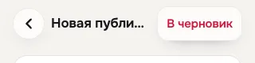

## Доступы

### PRF-009 · P2 — Внизу: «Кто может просить доступ и запросы к тебе — в «Я → Видимость»».

Внизу: «Кто может просить доступ и запросы к тебе — в «Я → Видимость»». В «Видимости» этого нет: запросы доступа и «Кто может просить доступ» лежат в «Я → Приватное». В режиме «Мы» текст тот же, «к тебе».

**Исправление:** prototype-v20.html:6635 accessBody: заменить текст и сделать `<button class="plink" data-go="X01" data-p='{"layer":"priv"}'>` ; для actionAuthor()==='couple' — «к вам».

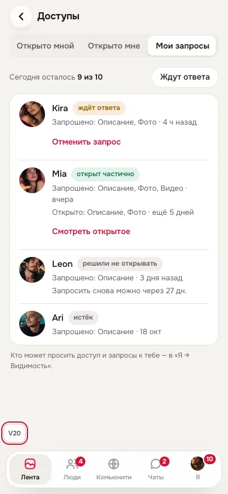

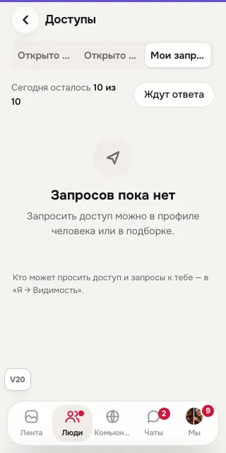

### PRF-010 · P2 — На 320 подписи вкладок обрезаны: «Открыто …», «Открыто …», «Мои запр…».

На 320 подписи вкладок обрезаны: «Открыто …», «Открыто …», «Мои запр…». «Сегодня осталось 10 из 10» переносит «10» на вторую строку. QA-пункт «Доступы · ко мне» открывает «Открыто мной» — вкладки входящих запросов в P07 нет.

**Исправление:** prototype-v20.html:6627 accessBody tabs: подписи L('Открыто мной')→«Я открыл·а» и т.п. либо класс 'scroll'; строку лимита сделать `white-space:nowrap` у <b>. QA_LIST (8093): {tab:'in'}→ X01 {layer:'priv'}.

### VIS-014 · P2 — Длинный ник (например, «anastasia_valentina2», «jean.baptiste.montgo») наезжает на плашку «ещё 5 дней» /…

Длинный ник (например, «anastasia_valentina2», «jean.baptiste.montgo») наезжает на плашку «ещё 5 дней» / «ещё 23 ч» — текст и плашка перекрываются.

**Исправление:** В строке P07 (`.rqcard` заголовок) сделать сетку `grid-template-columns:minmax(0,1fr) auto` и на имени `overflow:hidden;text-overflow:ellipsis;white-space:nowrap` (или `overflow-wrap:anywhere`), плашке — `flex:none;margin-left:8px`.

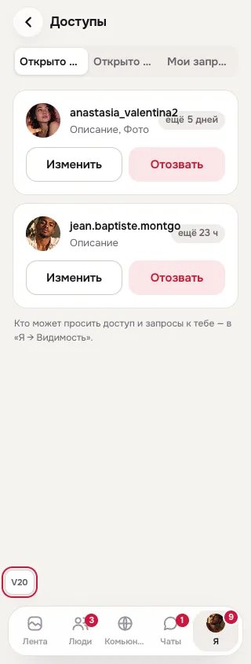

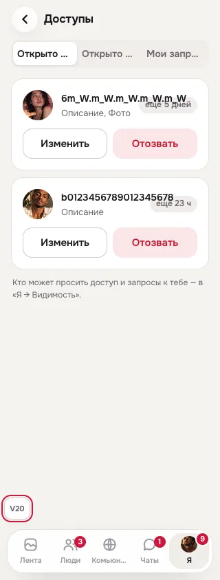

### PRF-016 · P3 — В карточке: «Kai · Видео, Описание», в листе «Доступ для Kai» чипы в порядке «Видео», «Описание».

В карточке: «Kai · Видео, Описание», в листе «Доступ для Kai» чипы в порядке «Видео», «Описание». Везде в других местах порядок «Описание, Фото, Видео».

**Исправление:** prototype-v20.html cleanScopes: возвращать REQ_SCOPES.map(x=>x[0]).filter(k=>arr.includes(k)); grOk/nwOk сохранять результат cleanScopes.

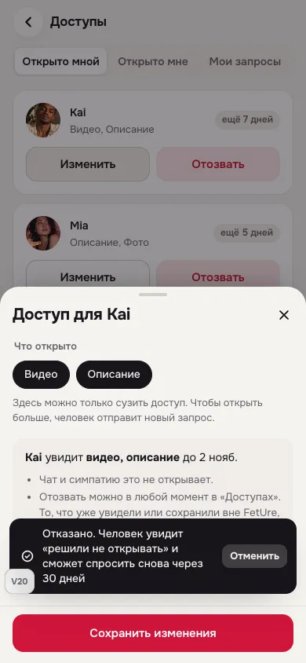

### PRF-017 · P3 — В профиле: «Отозвать запрос».

В профиле: «Отозвать запрос». В P07 и в листе «Запрос уже отправлен»: «Отменить запрос». «Отозвать» в этом же разделе означает забрать выданный доступ («Отозвать доступ у Kai?»).

**Исправление:** prototype-v20.html:6179 veilAction: L('Отозвать запрос')→L('Отменить запрос').

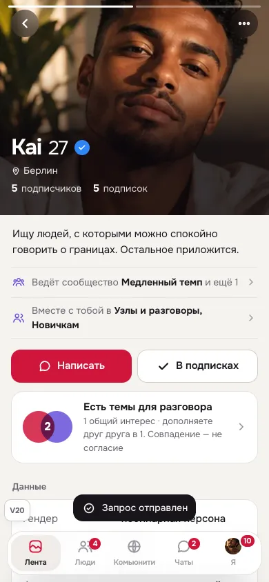

### PRF-018 · P3 — Строка Ari «истёк» без действия «Запросить снова».

Строка Ari «истёк» без действия «Запросить снова». У Ari и Leon в профиле нет приватной части вообще, поэтому состояния вуали «Прежний доступ закончился → Запросить снова» и «Решили не открывать · запросить снова через N дн.» в демо недостижимы (unreachable).

**Исправление:** prototype-v20.html:6630 accessBody: для r.status==='expired' добавить `<button class="btn text" data-act="reqAccess" data-v="${r.p}">Запросить снова</button>`; в PEOPLE (3110+) у ari и leon добавить privText.

### PRF-019 · P3 — Заголовок «Открыть доступ» без имени и без строки, что именно человек просил.

Заголовок «Открыть доступ» без имени и без строки, что именно человек просил. Чипы «Описание», «Фото», «Видео» — выбраны те, что запрошены, но не отмечено, что «Видео» не запрашивали. Отказать из листа нельзя.

**Исправление:** prototype-v20.html grantSheet (6650): title L(`${pname(r.p)} просит доступ`), sub: SCOPE_TXT(r.scopes); foot добавить data-act="decline" data-v=r.id.

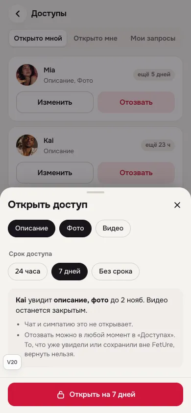

## Инструменты прототипа

### GEN-003 · P3 — Плавающая кнопка «V20» (левый нижний угол) перекрывает продуктовые элементы — вторичную кнопку «У меня уже…

Плавающая кнопка «V20» (левый нижний угол) перекрывает продуктовые элементы — вторичную кнопку «У меня уже есть аккаунт» на приветствии, нижние CTA, текст над доком. Заголовок панели экранов — «FetUre V14», хотя версия V20.

**Исправление:** `#qaFab`: `left:auto;right:0;width:20px;border-radius:10px 0 0 10px;opacity:.5` с раскрытием по hover/tap; заменить текст «V14» в `
` на актуальную версию.

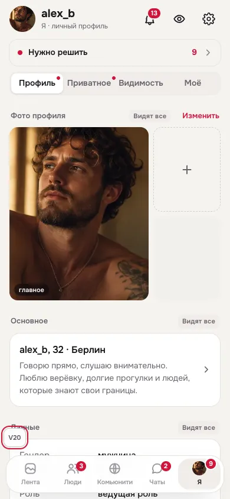

## Лента

### FEED-007 · P2 — Экран пустой: только заголовок «Мои публикации» и кнопка «+», без текста и без кнопки создания.

Экран пустой: только заголовок «Мои публикации» и кнопка «+», без текста и без кнопки создания. Пустое состояние показывается лишь когда S.myPosts пуст целиком (а у Alex есть личные посты).

**Исправление:** В SC.F10 заменить условие !S.myPosts.length на !(drafts.length+review.length+pub.length+edits.length+jointPending.length); текст для owner==='couple': «У пары пока нет публикаций», кнопка «Создать публикацию от пары».

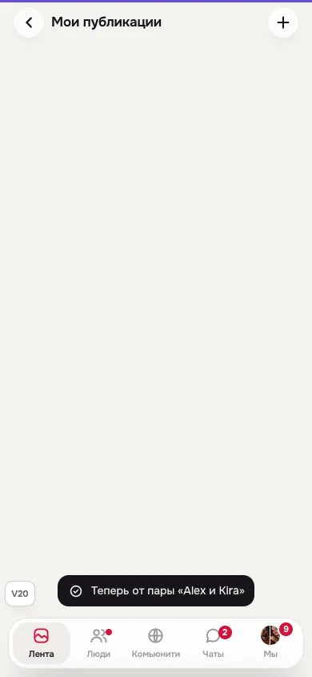

### FEED-010 · P2 — Пустое состояние: «Ничего не нашлось.

Пустое состояние: «Ничего не нашлось. С такими фильтрами публикаций нет. Сними один из фильтров.» и кнопка «Сбросить фильтры» — хотя фильтров нет, а сброс ничего не возвращает.

**Исправление:** В SC.F01 различать причины: n>0 → текущий текст; иначе если feedSet('hiddenPosts').size+feedSet('mutedAuthors').size>0 → empty('eyeoff','Всё скрыто','Публикации скрытых авторов и скрытые посты не показываются.', кнопка «Показать скрытое»); иначе — «Пока нет публикаций» с кнопкой «Найти людей».

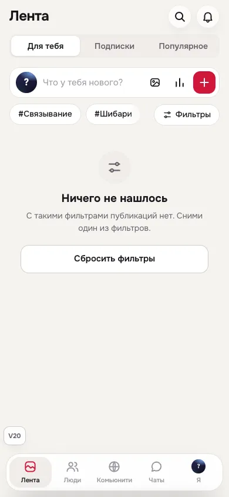

### FEED-012 · P2 — Кнопка — «Отправить на проверку», подпись под аудиторией — «С фото и видео — после короткой проверки», хотя…

Кнопка — «Отправить на проверку», подпись под аудиторией — «С фото и видео — после короткой проверки», хотя такая правка по правилу V20 идёт в публикацию сразу без проверки. Тоста об итоге нет (FEED-004), так что пользователь уверен, что пост ушёл на проверку.

**Исправление:** В SC.F07: если ex&&ex.status==='published', считать need=editNeedsReview(ex,postFromDraft(draftOf(r),ex.id,ex)) при рендере (или на input с debounce) и подставлять текст кнопки publishNow и строку who; то же в SC.F09.

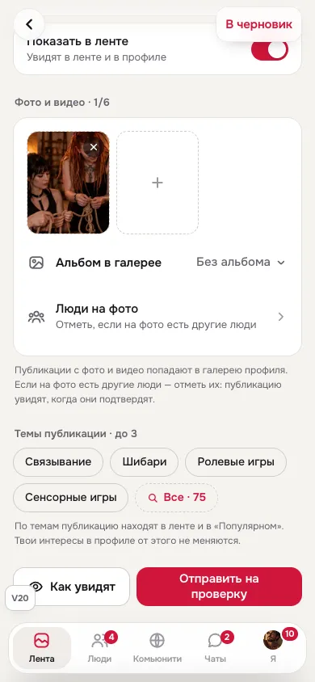

### FEED-013 · P2 — В режиме пары тексты обращаются к одному человеку и говорят о личном профиле: «Видно в ленте и в твоём…

В режиме пары тексты обращаются к одному человеку и говорят о личном профиле: «Видно в ленте и в твоём профиле», «Только те, кто подписан на тебя», «Люди, у которых есть доступ к твоей приватной части», «Твои интересы в профиле от этого не меняются», плейсхолдер «О чём хочется рассказать?». При этом рядом: «От пары — появится сразу, у вас обоих».

**Исправление:** Сделать AUD(author) зависимым от автора (prototype-v20.html:5699) и передавать r.author в F07/F09; foot у «Темы публикации» (5736) — через L с вариантом для пары; ph в rteField (5733) — вариант «О чём хотите рассказать?» для пары.

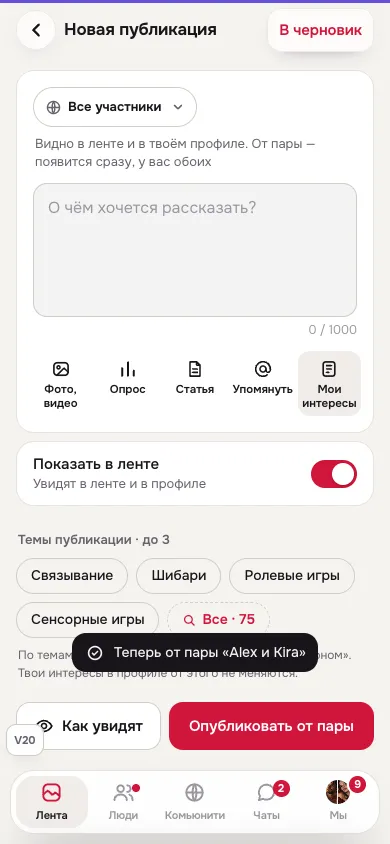

### FEED-017 · P2 — Текст: «Подпишись на авторов и сообщества — их публикации появятся здесь», кнопки «Найти людей» и…

Текст: «Подпишись на авторов и сообщества — их публикации появятся здесь», кнопки «Найти людей» и «Сообщества». Но вступление в сообщество не добавляет в «Подписки» ничего (followStream берёт только посты и активность людей). Над пустым состоянием показаны быстрые чипы тем и «Фильтры», которые здесь ничего не фильтруют.

**Исправление:** SC.F01 (prototype-v20.html:5270): поправить текст и кнопки; не рендерить .filterline при sub==='following'&&!followingOf(actor).length. Либо добавить в followStream обсуждения из joinedSet() как k:'disc'.

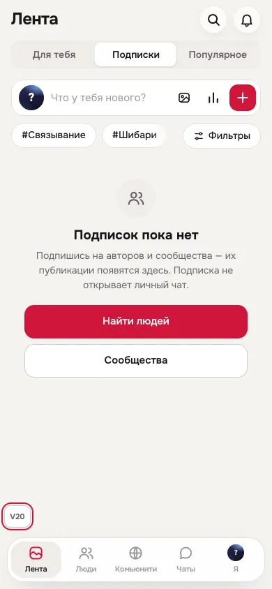

### FEED-018 · P2 — Диалог «Выйти без сохранения?

Диалог «Выйти без сохранения? Изменения в форме будут потеряны.» с кнопками «Выйти» / «Остаться». Варианта «Сохранить в черновик» нет, хотя черновики есть и кнопка «В черновик» стоит в шапке.

**Исправление:** В confirmLeave (prototype-v20.html:3870/3887) для route.id==='F07'&&!route.p.community добавить действие «Сохранить черновик», вызывающее ACT.saveDraft и затем back().

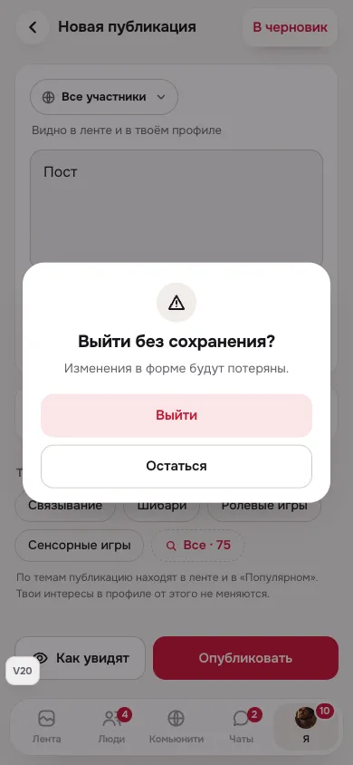

### FEED-019 · P2 — Тосты: «Сохранено — найдёшь в «Профиль → Сохранённое»» и «Черновик сохранён в «Профиль → Мои публикации»».

Тосты: «Сохранено — найдёшь в «Профиль → Сохранённое»» и «Черновик сохранён в «Профиль → Мои публикации»». В приложении нет такого пути: вкладка «Профиль» в «Я» — это публичный профиль; «Сохранённое» и «Публикации и статьи» лежат в «Я → Моё».

**Исправление:** Исправить строки в ACT.savePost (prototype-v20.html:5363) и ACT.saveDraft (5789) (RU и EN: «Me → Mine → Saved»).

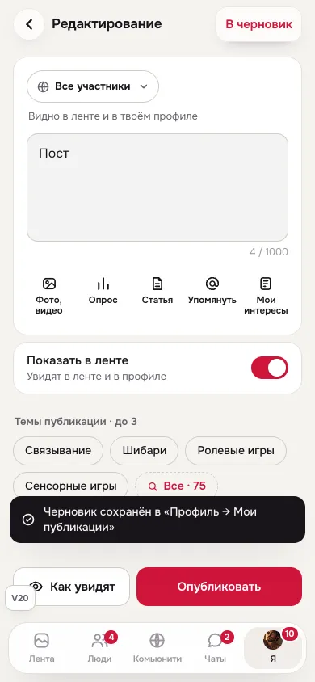

### FEED-020 · P2 — Лента: вкладка «Популярн…» обрезана многоточием; плейсхолдер композера переносится в две строки («Что у тебя…

Лента: вкладка «Популярн…» обрезана многоточием; плейсхолдер композера переносится в две строки («Что у тебя / нового?»); второй быстрый чип обрезан. Редактор: заголовок «Новая публи…» обрезан из‑за кнопки «В черновик»; нижняя панель занимает две строки («Как увидят» и «Опубликовать» друг под другом, ~140 px); пять инструментов переносятся во 2-й ряд, и полезная область редактора ~400 px.

**Исправление:** CSS @media (max-width:359px): .seg.sm button{padding:0 8px;font-size:13px}; .composer .cmp-main span{white-space:nowrap;overflow:hidden;text-overflow:ellipsis}; в F07 при узкой ширине рендерить «В черновик» как ibtn с I.doc; .ctabar .row: «Как увидят» → ibtn; .attach.v14{flex-wrap:nowrap;overflow-x:auto}.

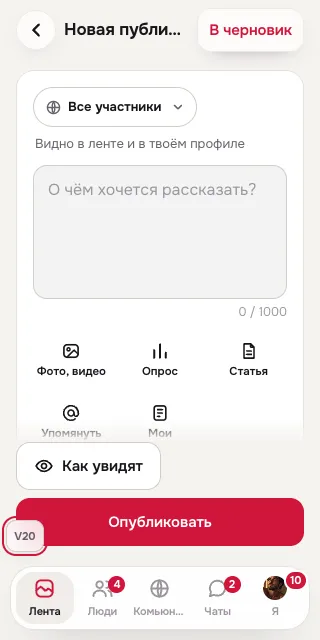

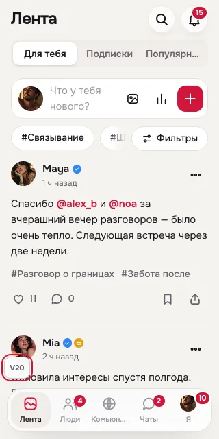

### FEED-023 · P3 — Видно 4 миниатюры целиком и кнопка «+7»: 4+7=11, а публикаций 10.

Видно 4 миниатюры целиком и кнопка «+7»: 4+7=11, а публикаций 10. Аналогично «+3» при 6 и «+2» при 5. actFit считает скрытой плитку, правый край которой заходит под зону edge-14 px, хотя она видна полностью.

**Исправление:** actFit (prototype-v20.html:5332): считать скрытыми плитки с offsetLeft+offsetWidth > s.scrollLeft+s.clientWidth+1 (без вычета 14 px) либо вычитать ширину кнопки только если она перекрывает плитку.

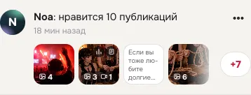

### FEED-024 · P3 — В списках сам пользователь показан как посторонний: «alex_b · мужчина, би», «alex_b, 32 · мужчина, би».

В списках сам пользователь показан как посторонний: «alex_b · мужчина, би», «alex_b, 32 · мужчина, би». При этом в «Нравится» тот же человек — «Ты», а в строке «Нравится: тебе…».

**Исправление:** Вынести selfRow(id) (как в ACT.likers, prototype-v20.html:5593) и использовать в actPrev (5306), ACT.pollPeople (4321) и других personRow-списках ленты.

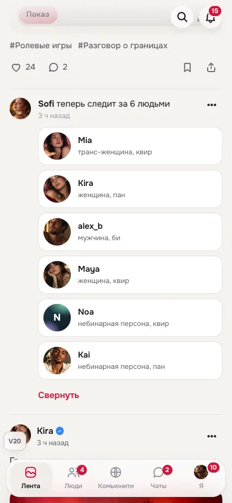

### FEED-026 · P3 — Заголовок экрана — «Публикация» (не «Статья»); под статьёй строка «0 ответов» и пустота — нет приглашения…

Заголовок экрана — «Публикация» (не «Статья»); под статьёй строка «0 ответов» и пустота — нет приглашения ответить. Кнопка «Следить за статьями» автора есть только в профиле, не под статьёй.

**Исправление:** SC.F05.render (prototype-v20.html:5673): bar(x.type==='note'?L('Статья','Article'):…); при !x.comments.length вместо пустоты — 
…
 с data-act="focusReply"; добавить noteSubRow(x.author) для x.type==='note'&&!ownedIdentity(x.author).

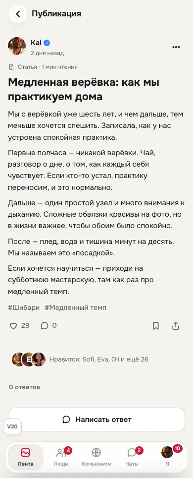

### FEED-027 · P3 — Фон просмотрщика полупрозрачный: сверху и снизу сквозь него читаются имя автора, текст поста и иконки дока.

Фон просмотрщика полупрозрачный: сверху и снизу сквозь него читаются имя автора, текст поста и иконки дока. Счётчик «3 / 4» и крестик лежат поверх этого шума. Свайп влево/вправо, стрелки, Esc, свайп вниз и крестик работают.

**Исправление:** CSS .viewer: background:#000 (сейчас полупрозрачный); прозрачность только в состоянии .viewer.drag через calc от --dy.

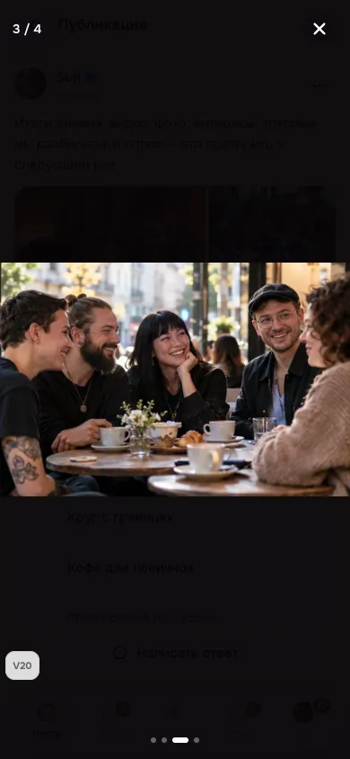

### FEED-028 · P3 — В листе «Создать» нет «Статьи» (подпись «Текст, до 6 фото или видео, опрос или твои интересы»), статья…

В листе «Создать» нет «Статьи» (подпись «Текст, до 6 фото или видео, опрос или твои интересы»), статья доступна только кнопкой внутри редактора. Названия расходятся: «Фото/видео» (лист) ↔ «Фото, видео» (редактор), «Интересы» ↔ «Мои интересы». Иконка «Мои интересы» (I.test — лист с линиями) почти не отличается от иконки «Статья» (I.doc). Комментарий в коде «three things, not six», а пунктов два.

**Исправление:** ACT.create (prototype-v20.html:5693): добавить пункт ['post','doc',…,'Статья','Длинный текст с заголовком'] с data-x="note" (createType → go('F07',{x:'note'})); унифицировать подписи в ACT.create и tools F07 (5725); заменить I.test на I.spark в обоих местах.

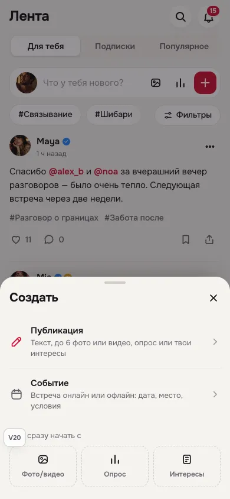

### FEED-029 · P3 — Заголовок — «Редактирование», как для опубликованного поста; кнопка внизу — «Опубликовать».

Заголовок — «Редактирование», как для опубликованного поста; кнопка внизу — «Опубликовать». Из заголовка не видно, что это черновик.

**Исправление:** SC.F07 bar (prototype-v20.html:5731): ex?.status==='draft'?L('Черновик','Draft'):ex?…

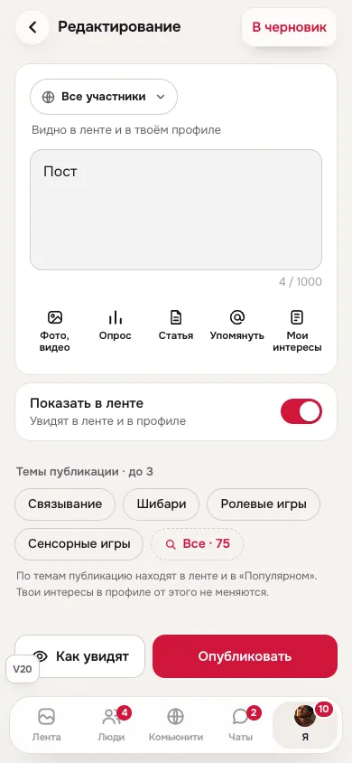

### FEED-030 · P3 — Фото оказываются ниже переключателя «Показать в ленте», отдельной карточкой под заголовком «Фото и видео ·…

Фото оказываются ниже переключателя «Показать в ленте», отдельной карточкой под заголовком «Фото и видео · 1/6» — далеко от текста, к которому относятся. На 390 px кнопка «Отправить на проверку» переносится в две строки рядом с «Как увидят».

**Исправление:** SC.F07: перенести ${mediaBlock} внутрь 
 после ${tools} (или сразу после rteField); сократить подпись кнопки до L('На проверку','Submit'); .ctabar .row .btn{white-space:nowrap}.

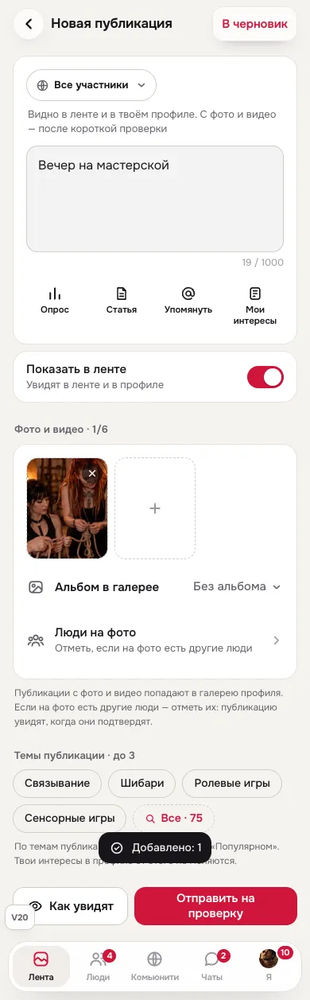

### FEED-031 · P3 — 7 из 14 чипов («#Эксперименты», «#D/s-динамика», «#Связывание», «#Контроль», «#Спанкинг», «#Тантра»,…

7 из 14 чипов («#Эксперименты», «#D/s-динамика», «#Связывание», «#Контроль», «#Спанкинг», «#Тантра», «#Игрушки») дают пустой экран «За неделю тихо». Ряд чипов длинный и прокручивается.

**Исправление:** popularFeed (prototype-v20.html:5564): mine.filter(t=>popularPosts(t).length+popularDiscs(null,t).length) и сортировка по этой сумме.

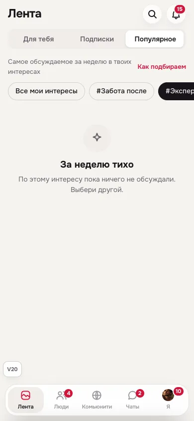

### FEED-032 · P3 — Пустая тема: «Публикаций по интересу пока нет.» — без кнопки «Написать первым».

Пустая тема: «Публикаций по интересу пока нет.» — без кнопки «Написать первым». Лупа открывает общий поиск G01 с пустой строкой, без темы. Плашка «Шибари 6 даю» под описанием не подписана — неясно, что это мой интерес и что по нажатию откроется редактор.

**Исправление:** SC.F04 (prototype-v20.html:5685–5690): в пустом блоке <button class="btn soft" data-go="F07" data-p='{"tags":["id"]}'>, поддержать p.tags в F07 init (r.tags=p.tags||[]); searchBtn('posts') → передавать {q:'#'+topic}; добавить 
Твой интерес
 перед jarsHTML.

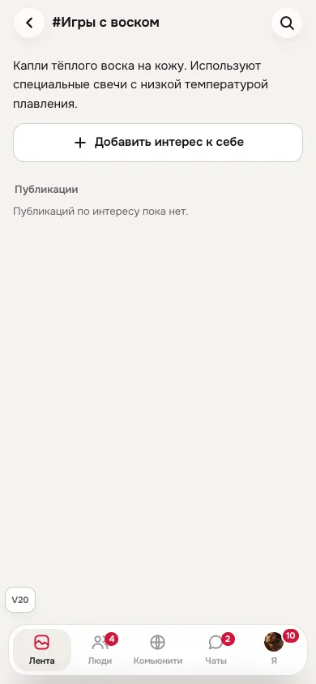

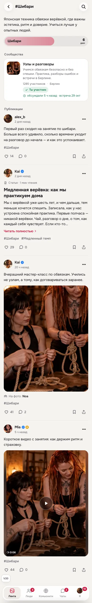

### FEED-033 · P3 — После отправки остаёшься на той же странице, публикация полностью видна, без отметки «Ты пожаловался».

После отправки остаёшься на той же странице, публикация полностью видна, без отметки «Ты пожаловался». После «Это я на фото» тост «Публикация скрыта…», но пост остаётся на экране как ни в чём не бывало.

**Исправление:** ACT.rpSend (prototype-v20.html:6577) и ACT.tagObject (5550): если cur().id==='F05'&&cur().p.id===post → back(); либо рендерить consent-note/report-note в postCard при S.reportedPosts.has(id).

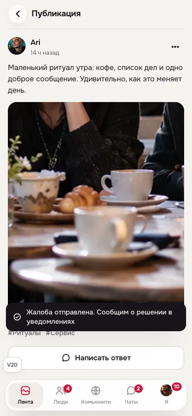

### FEED-034 · P3 — Меню поста открывается модальным окном по центру экрана с затемнением, далеко от кнопки ⋯ (на десктопе…

Меню поста открывается модальным окном по центру экрана с затемнением, далеко от кнопки ⋯ (на десктопе «Действовать как» уже открывается поповером у кнопки). В строке быстрых чипов перед «Фильтры» виден обрезанный кусочек пятого чипа («#»).

**Исправление:** В sheet() для меню (postMenu, rMore, actMenu, discMenu) на desktop-ширине использовать существующий поповер (как у dockMe на десктопе); .filterline .chips.scroll — mask-image:linear-gradient(to right,#000 90%,transparent).

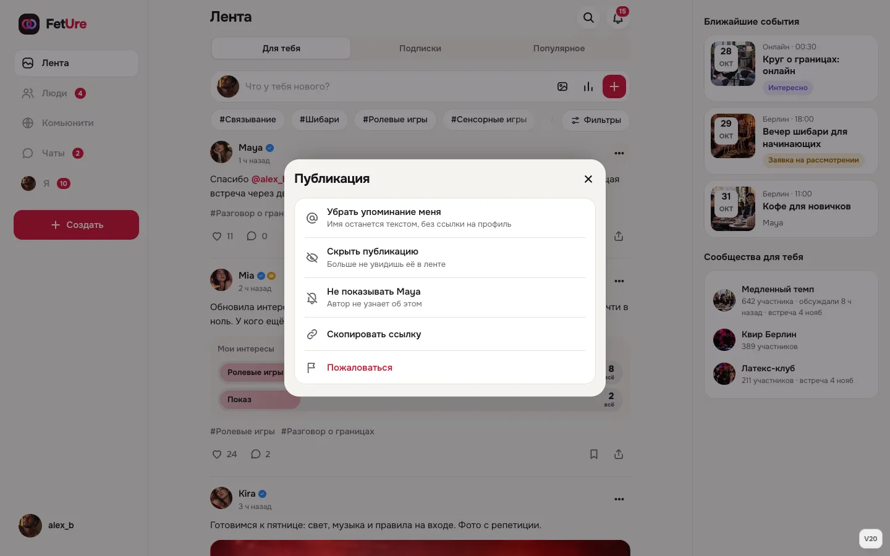

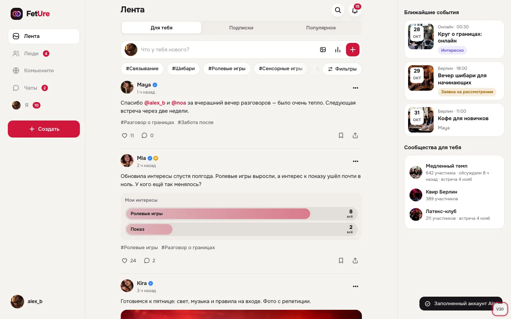

### FEED-035 · P3 — Кнопка — просто «Применить», без количества; можно собрать комбинацию с 0 результатов и узнать об этом…

Кнопка — просто «Применить», без количества; можно собрать комбинацию с 0 результатов и узнать об этом только после применения («Ничего не нашлось»). В коде уже есть applyLabel «Показать N публикаций / Нет подходящих публикаций», но лист вызван с noCount:1.

**Исправление:** ACT.feedFilters (prototype-v20.html:5347): убрать noCount:1; для «Подписок» count считать по followStream, а не по постам.

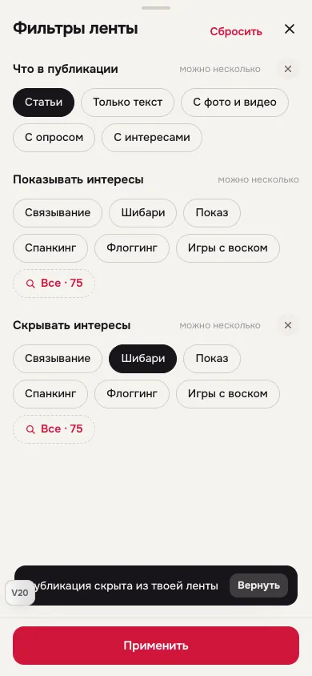

### FEED-036 · P3 — Строка «Нравится: Ira, Nika, Lina и ещё 9» с аватарами стоит отдельно под рядом действий с отступом ~40 px…

Строка «Нравится: Ira, Nika, Lina и ещё 9» с аватарами стоит отдельно под рядом действий с отступом ~40 px сверху и вплотную к «7 ответов», визуально не связана ни с сердцем, ни с постом.

**Исправление:** CSS .likes-line: margin-top:4px; в SC.F05 вставлять likesLine внутрь article.post (после .post-a), а не после него.

### FEED-037 · P3 — Метка на карточке — «Note · 1 min read», инструмент — «Note», чип режима — «Note», фильтр — «Notes», а…

Метка на карточке — «Note · 1 min read», инструмент — «Note», чип режима — «Note», фильтр — «Notes», а заголовок редактора — «New article», «Edit article». Changelog V20 переименовал «Заметку» в «Статью».

**Исправление:** Заменить EN-строки 'Note'/'Notes' на 'Article'/'Articles' в TYPES (prototype-v20.html:5236), noteBody (5752), tools F07 (5725), note-mode (5733).

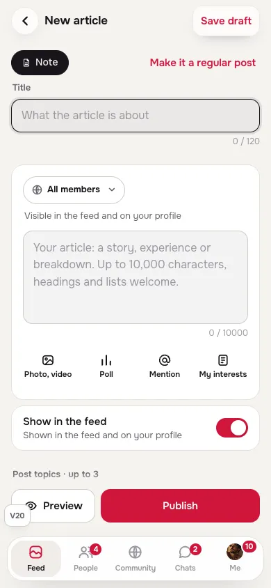

### FEED-038 · P3 — Поле «Заголовок» стоит над карточкой редактора отдельно, а выбор аудитории «Все участники» — внутри карточки…

Поле «Заголовок» стоит над карточкой редактора отдельно, а выбор аудитории «Все участники» — внутри карточки между заголовком и текстом. Порядок: заголовок → аудитория → текст.

**Исправление:** SC.F07 (prototype-v20.html:5732–5733): переместить field ntitle внутрь .card.compose после .cmp-ctx/.cmp-who.

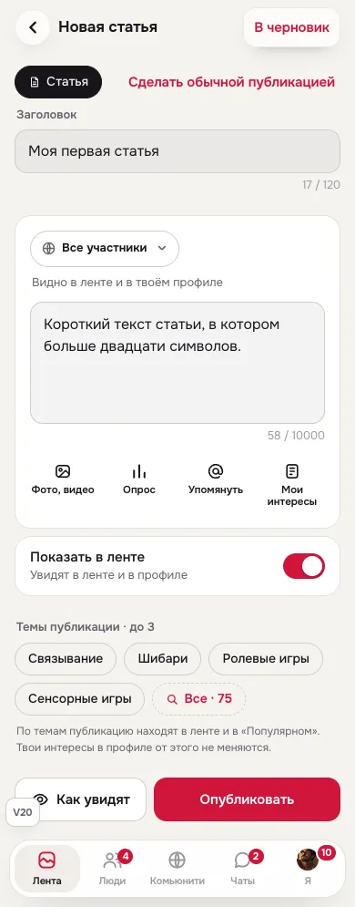

### FEED-039 · P3 — Диалог закрывается, появляется тост «Нужна ссылка, начинающаяся с https://», введённый адрес потерян — надо…

Диалог закрывается, появляется тост «Нужна ссылка, начинающаяся с https://», введённый адрес потерян — надо открывать диалог и вводить заново. Поля «Текст ссылки» нет. Введённое значение в поле выглядит серым, как плейсхолдер.

**Исправление:** В обработчике rte link (prototype-v20.html:4480): валидировать до закрытия ask (ask с validate) либо при отсутствии схемы подставлять 'https://'+u; добавить второе поле для текста; цвет .inp значения — var(--ink).

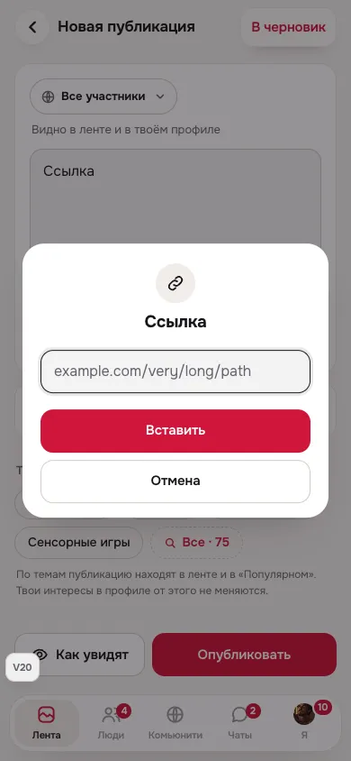

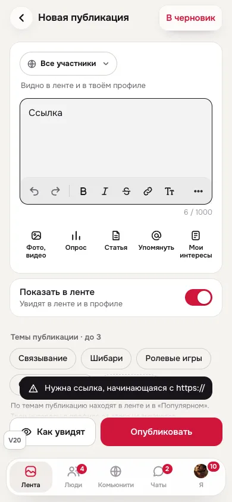

### FEED-040 · P3 — В предпросмотре на карточке розовый баннер «Ждём согласия: Sofi.

В предпросмотре на карточке розовый баннер «Ждём согласия: Sofi. Пока все отмеченные не подтвердят, публикацию видишь только ты и они» — ещё до отправки (запрос Sofi не отправлен). Ниже ещё карточка «Проверка фото и видео… До этого публикацию видишь только ты». Карточка «Кто увидит» с лишним пустым местом под строкой.

**Исправление:** postCard(fake,{preview:1}) — не выводить consentNote при o.preview; в SC.F09 (prototype-v20.html:5794) объединить ряды в один список шагов; убрать лишний отступ в .card.list .li с selectRow.

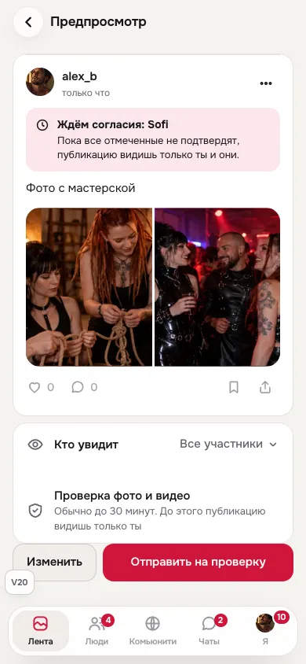

### FEED-043 · P3 — У поста — «♡ 12 · 💬 7 · закладка · поделиться»; у обсуждения — только «♡ 0», без счётчика ответов,…

У поста — «♡ 12 · 💬 7 · закладка · поделиться»; у обсуждения — только «♡ 0», без счётчика ответов, сохранения и ссылки (ссылка спрятана в ⋯). Заголовок «2 ответа» в обсуждении считает и скрытый ответ заблокированного автора.

**Исправление:** Вынести ряд .post-a в функцию actionRow(item,kind) и использовать в postCard и в карточке обсуждения C06 (s-comm.js); для обсуждений — savePost/discLink.

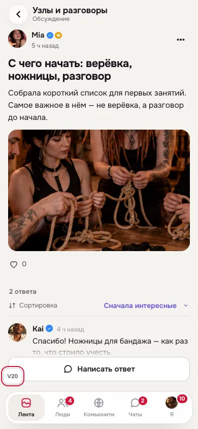

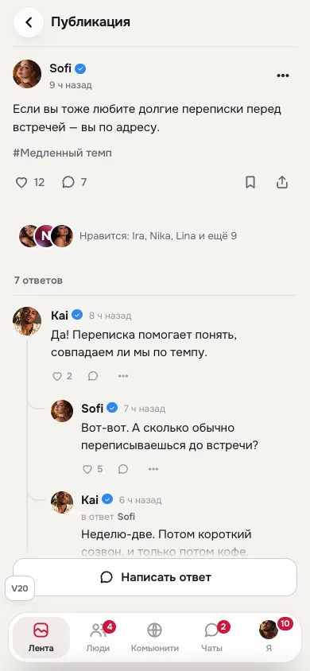

## Люди

### PPL-004 · P2 — Закрывается всё окно фильтров, черновик пропадает.

Закрывается всё окно фильтров, черновик пропадает. При повторном открытии — «везде · Показать · 11», все выбранные значения сброшены. В окне «Город» нет кнопки «Назад», только ✕.

**Исправление:** prototype-v20.html:6289 dfSheet: передать в sheet() onClose, который при S.ui.dfsub делает ACT.dfBack() и возвращает false (не закрывать). ACT.dfCity (6330): openCityPicker с lead-кнопкой «Назад к фильтрам» и onCancel → dfSheet().

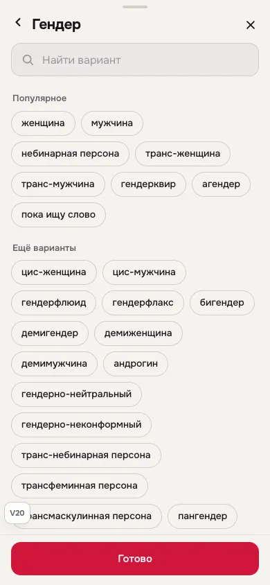

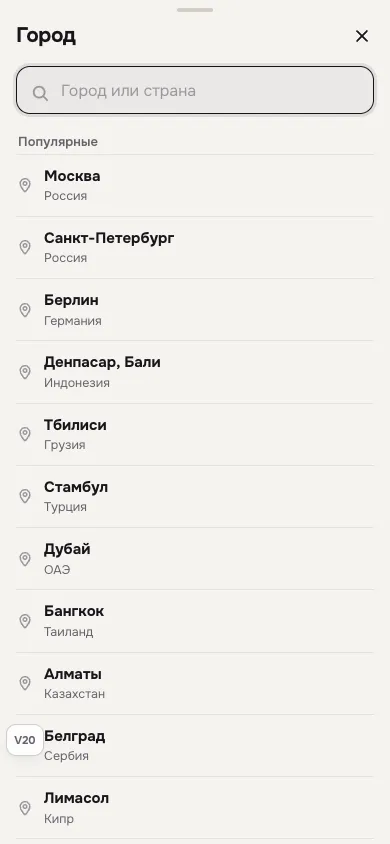

### PPL-005 · P2 — На фото: «2 общих интереса».

На фото: «2 общих интереса». В блоке: кружок «2», текст «1 общий интерес · дополняете друг друга в 1». На «Это взаимно»: «2 совпадения, дополняете в 1». У Zoe в «Мы»: кружок «3» и «1 общий интерес · дополняете друг друга в 2».

**Исправление:** prototype-v20.html:4276 compatWords и 4282 sharedSummary: первым словом выводить общее число sh.match.length («N общих тем»), затем разбивку «совпадает X · дополняете Y». card() (6153 pc-score): подпись «общая тема/общих темы». Слово «совпадение» на «Это взаимно» заменить на «общих тем».

### PPL-006 · P2 — «Ты и Lena и Max понравились друг другу».

«Ты и Lena и Max понравились друг другу». ««Alex и Kira» и Lena и Max понравились друг другу». «Чат откроется, если Nika и Jonas ответит взаимностью». В P05: «Ты и Eva и Tom», ««Alex и Kira» и Eva и Tom».

**Исправление:** Ввести helper nameQ(id)=PEOPLE[id]?.pair?`«${pname(id)}»`:pname(id) и использовать в showMatch (6232), likePerson toast (6228, «ответит»→ PEOPLE[id].pair?'ответят':'ответит'), SC.P05 шапка (6586), accessSummary, reqCardHTML.

### PPL-007 · P2 — Тост «Вправо — нравится, влево — пропустить» встаёт на top:64px поверх верхней части карточки и закрывает…

Тост «Вправо — нравится, влево — пропустить» встаёт на top:64px поверх верхней части карточки и закрывает метки «Ты нравишься» и «2 общих интереса». Класс #toasts.at-top остаётся до следующего показа тоста, и последующие тосты на подборке (например «Вернули предыдущую анкету») тоже ложатся поверх меток.

**Исправление:** prototype-v20.html:6123 SC.D03.after: вместо toast(...)+at-top вставить в .dating-bar строку `
` и убрать через 2600 мс; либо снимать класс at-top через setTimeout(…,2700). CSS 2961 #toasts.at-top можно удалить.

### PPL-010 · P3 — Тап по пропущенной анкете сразу возвращает её в подборку (тост «Kira снова в подборке»), профиль не…

Тап по пропущенной анкете сразу возвращает её в подборку (тост «Kira снова в подборке»), профиль не открывается. Карточка остаётся в «Пропущенных» с крестиком, и повторный тап снова пишет «снова в подборке».

**Исправление:** prototype-v20.html:6324 SC.D09: hcard для h.d<0 — data-go P01, плюс кнопка `.mk` с data-act="restore"; ACT.restore (6328) помечать h.restored=true и рендерить метку.

### PPL-011 · P3 — Тёмная карточка «Вся история за неделю» перекрывает последний ряд сетки (седьмую карточку видно наполовину).

Тёмная карточка «Вся история за неделю» перекрывает последний ряд сетки (седьмую карточку видно наполовину). Лист Premium, который открывается по тапу на скрытую карточку, без заголовка (у #sheet нет h2).

**Исправление:** CSS .paywall в D09 — убрать position:sticky/absolute, добавить margin-top:16px. premiumSheet: передавать title.

### PPL-012 · P3 — Над кнопкой одно слово «везде» строчной буквой.

Над кнопкой одно слово «везде» строчной буквой. «Сбросить» в шапке красная и активная, хотя сбрасывать нечего. Кнопки «✕» у отдельных фильтров — круг 24×24 px.

**Исправление:** prototype-v20.html:6302 dfSheet foot: `${dfCount(f)?`
${cap(dfSummary(f))}
`:''}`; head: класс off при !dfCount(f). CSS .fclr min 32px.

### PPL-013 · P3 — Заголовок «На сегодня анкеты закончились», хотя причина — фильтры (ниже «С текущими фильтрами больше никого»).

Заголовок «На сегодня анкеты закончились», хотя причина — фильтры (ниже «С текущими фильтрами больше никого»).

**Исправление:** prototype-v20.html:6240 deckEmpty: заголовок зависит от n; добавить dfWhyEmpty(filters).

### PPL-014 · P3 — Карточка «Lena и Max» выглядит как карточка человека: одно фото, имя без возраста, нигде нет пометки «пара».

Карточка «Lena и Max» выглядит как карточка человека: одно фото, имя без возраста, нигде нет пометки «пара».

**Исправление:** prototype-v20.html:6251 likesBody: в .inf для PEOPLE[l.p].pair добавить `<small class="pill">пара</small>`.

### PPL-015 · P3 — Кнопки «вернуть/пропустить/ключ/нравится» висят без подложки поверх текста: строка «Статус отношений /…

Кнопки «вернуть/пропустить/ключ/нравится» висят без подложки поверх текста: строка «Статус отношений / Формат отношений» видна сквозь и между кругами, в галерее плитки уходят под кнопки.

**Исправление:** CSS .acts:not(.onphoto){background:linear-gradient(to top,var(--card) 60%,transparent)} и .pc-body{padding-bottom:96px}.

### PPL-016 · P3 — Круглая ✕ сидит на верхнем правом углу тёмной карточки-баннера и наполовину вылезает за её край; рядом с…

Круглая ✕ сидит на верхнем правом углу тёмной карточки-баннера и наполовину вылезает за её край; рядом с пунктом «Вернуть пропущенных» пилюля «для этого» без пояснения.

**Исправление:** premiumSheet: заголовок листа и стандартная кнопка закрытия; текст пилюли L('нужно сейчас','needed now').

### PPL-017 · P3 — Esc закрывает слой (хорошо), но фокус уходит на кнопку QA «V20» — первая карточка подборки не получает фокус.

Esc закрывает слой (хорошо), но фокус уходит на кнопку QA «V20» — первая карточка подборки не получает фокус.

**Исправление:** prototype-v20.html:6236 ACT.matchClose: после refresh() `$('#acts .like')?.focus()`.

### VIS-015 · P3 — Ник рвётся посреди слова на две строки и затем обрезается: «konstanti / n.wolfg…».

Ник рвётся посреди слова на две строки и затем обрезается: «konstanti / n.wolfg…».

**Исправление:** Для подписи плитки симпатий задать `white-space:nowrap;overflow:hidden;text-overflow:ellipsis;max-width:100%`.

## Навигация (док)

### VIS-001 · P2 — Подпись средней вкладки обрезается до «Комьюн…» на каждом экране.

Подпись средней вкладки обрезается до «Комьюн…» на каждом экране. Остальные подписи помещаются.

**Исправление:** 1) Переименовать вкладку по спецификации (см. GEN-001). 2) В правиле `.dock button span` (prototype-v20.html:159, переопределение :1202) убрать `text-overflow:ellipsis`, а для узких экранов добавить `@container stage (max-width:359px){.dock button{font-size:10px;letter-spacing:-.02em}.dock button span{padding:0}}`. Если выбранное название всё равно не помещается в 58 px — использовать короткое «Группы»/«Круги» только в доке, полное — в заголовке экрана. Проверить RU и EN («Community»).

## Настройки и системные состояния

### SET-017 · P2 — Подсказки под полями 12 px имеют контраст 2,6:1 («Пароль не нужен — пришлём код из 6 цифр.», «Латиница,…

Подсказки под полями 12 px имеют контраст 2,6:1 («Пароль не нужен — пришлём код из 6 цифр.», «Латиница, цифры, точка и _…», «Нужна, чтобы подтвердить 18+…», «Точный ник — подарок нельзя…»), разделитель «или по почте» и «можно несколько» — тоже 2,6:1. Отсчёт «Новый код через 30 с» — 1,4:1 (inline color:var(--faint)). В тёмной теме подсказки 4,0:1.

**Исправление:** CSS: .fhint, .divider, .fin-t span — color:var(--mute) вместо var(--faint) (или затемнить --faint в light до ≈#7a736d и в dark до ≈#9a948e). A03 #resend: убрать inline style="color:var(--faint)", для disabled — color:var(--mute).

### SET-018 · P2 — Белый текст на красной основной кнопке в тёмной теме — 3,3:1 («Дальше», «Получить код», «Подтвердить»,…

Белый текст на красной основной кнопке в тёмной теме — 3,3:1 («Дальше», «Получить код», «Подтвердить», «Сохранить и продолжить», «Готово», «Вступить», «Оформить · 79,99 €», «Сделать селфи», «Разрешить камеру», «Понятно», «Подключить»); бейдж «−44%» и «для этого» — тоже 3,3:1. В светлой теме те же кнопки проходят.

**Исправление:** CSS тёмной темы: для .btn.primary использовать более тёмный оттенок бренда (например #D0123E→ фон #C0103A) или тёмный текст на светло-розовом; проверить .pill.hot и em-бейджи тарифа.

### SET-007 · P3 — Каналы в категориях — квадратные кнопки только с иконками (телефон/конверт): включено — чёрная заливка,…

Каналы в категориях — квадратные кнопки только с иконками (телефон/конверт): включено — чёрная заливка, выключено — контур; подписи «Пуш / Почта» только мелкими иконками в заголовке. Время тихих часов «23:00–08:00» изменить нельзя. Нижняя сноска частично перекрыта плавающей кнопкой QA «V20».

**Исправление:** SC.K05 (7716): в .nhead вместо ic() вывести текстовые подписи; .nt-t.on — background:var(--brand) (CSS .nt-t); под тумблером тихих часов два selectRow («С», «До») с шагом 30 мин.

### SET-008 · P3 — Почту, помеченную «основной», нельзя изменить (нет действия).

Почту, помеченную «основной», нельзя изменить (нет действия). У любого пользователя после «Подключить» Google показывает alex.b@gmail.com. «Это устройство» всегда «Android · Берлин», в том числе в браузере на компьютере. В одном списке три стиля кнопок: «Отвязать» (контур), «Подключить» (красная заливка), «Завершить» (розовая).

**Исправление:** SC.K06 (7735): добавить кнопку «Изменить» → A02-подобный экран смены почты; для Google хранить m.googleEmail при k6link; «Это устройство»: /Android|iPhone|iPad|Mac|Windows/ из navigator.userAgent; «Подключить» — btn sm soft.

### SET-009 · P3 — Кнопка «Скачать JSON» и файл feture-v6-data.json — технический термин и номер старой версии.

Кнопка «Скачать JSON» и файл feture-v6-data.json — технический термин и номер старой версии. Текст удаления у любого пользователя содержит «Профиль пары разъединится», даже у тех, кто не в паре; в режиме «Мы» непонятно, удаляется личный аккаунт или пара. Enter в поле ника ничего не делает. Ник сравнивается с учётом регистра («ALEX_B» ≠ «alex_b»), хотя ники уникальны без учёта регистра.

**Исправление:** s-completion.js 7857: replace на L(«Скачать мои данные»); downloadFile(…, `feture-data-${date}.json`). SC.K07 (7744): фразу о паре выводить по activePair(). ACT.k7del (7748): input data-enter="k7do". ACT.k7do (7749): v.toLowerCase()!==S.me.nick.toLowerCase().

### SET-011 · P3 — Строка «Размывать входящие фото и видео» — единственная без иконки, текст начинается на 36 px левее, чем у…

Строка «Размывать входящие фото и видео» — единственная без иконки, текст начинается на 36 px левее, чем у соседних карточек. Иконка «Фото-верификация» залитая, остальные контурные. В режиме «Мы» строка «Заблокированные» показывает блоки пары (0/1) без пометки, что это блоки пары, хотя остальные строки — общие для аккаунта.

**Исправление:** SC.K01 (7696): toggleRow("k4blur",…) с иконкой (I.eyeoff) — как у .li с .ico; иконка verified — контурный вариант; sub для P12 — activeActor()==="couple" ? L(«Блоки пары»…) : …

### SET-015 · P3 — На A01 полосы «Нет соединения» нет.

На A01 полосы «Нет соединения» нет. На A02 и других экранах входа полоса говорит «Нет соединения — показываем сохранённое», хотя «сохранённого» на форме регистрации нет. Серверные действия корректно падают с тостом «Нет соединения. Ничего не отправлено — попробуй ещё раз · Повторить» (K06, K07, P12, вход, код, A04, «Готово»). Но переключатели настроек (размытие, язык, режим и каналы уведомлений, тихие часы) «сохраняются» офлайн с тостами успеха, хотя это серверные настройки профиля.

**Исправление:** render() (3929): для SC[id].auth и A01 выводить netbar с отдельным текстом; A01 render — добавить место для полосы. ACT.k4blur/k2/k5mode/k5ch/k5cat/k5quiet (7702–7734): оборачивать изменение в run(null,…) как k4act.

### SET-016 · P3 — Экран «Скоро вернёмся» без логотипа FetUre; иконка шестерёнки 20 px без фона (класс ico v не даёт плашки),…

Экран «Скоро вернёмся» без логотипа FetUre; иконка шестерёнки 20 px без фона (класс ico v не даёт плашки), на 1440 выглядит как случайный глиф. Запрос, начатый до техработ, после их окончания молча теряется: ни перехода на A03, ни ошибки, кнопка снова активна. Введённая почта сохраняется — это хорошо.

**Исправление:** SC.MAINT (7841): добавить  и стили .maintenance-screen .ico{width:56px;height:56px;border-radius:18px;display:grid;place-items:center;background:var(--v-soft)}. run() (3802): вместо молчаливого return при QA.maintenance — запомнить и после выключения показать toast(NETFAIL-подобный текст про техработы).

### SET-021 · P3 — Почта в подписи «Вход и безопасность» переносится на 4 строки посреди адреса, строка списка становится в 3…

Почта в подписи «Вход и безопасность» переносится на 4 строки посреди адреса, строка списка становится в 3 раза выше соседних.

**Исправление:** linkRow sub в K01: класс .one (white-space:nowrap;overflow:hidden;text-overflow:ellipsis).

## Общие компоненты

### VIS-002 · P1 — Подписи вкладок обрезаются многоточием: P07 — «Открыто … / Открыто … / Мои запр…» (две первые вкладки…

Подписи вкладок обрезаются многоточием: P07 — «Открыто … / Открыто … / Мои запр…» (две первые вкладки становятся неразличимы); G01 — «Публ… Сооб… Соб… Инте…» даже на 390–430 px; P01 — «Публика… Активнос… Сообщес…» на 375 px; P03 «Как видят» — «С досту… Знаком…» на 320 px; Лента — «Популярн…» на 320 px.

**Исправление:** Ввести единое правило для `.seg` (prototype-v20.html:248-256, 2218-2221): если сумма естественных ширин кнопок больше ширины контейнера — переключать сегмент в режим горизонтальной прокрутки: `.seg.scroll{display:flex;overflow-x:auto;scrollbar-width:none;mask-image:linear-gradient(90deg,#000 85%,transparent)} .seg.scroll button{flex:0 0 auto;padding:0 12px} .seg.scroll .knob{display:none} .seg.scroll button.on{background:var(--surf);box-shadow:0 1px 3px rgba(0,0,0,.12)}`. Добавлять класс `scroll` в `fitTabCounters()` (prototype-v20.html:3907), когда у любой кнопки `span.scrollWidth > span.clientWidth`. Дополнительно сократить подписи: P07 «Мне открыли / Я открыл(а) / Запросы» → «Ко мне / Мои / Запросы»; G01 убрать вкладку «Всё» из ряда или оставить 4 вкладки: «Люди, Посты, Сообщества, События» + интересы в выдаче «Всё».

### VIS-010 · P2 — Тост рисуется поверх листа у его нижнего края и закрывает содержимое: в листе «Удалить аккаунт навсегда?»…

Тост рисуется поверх листа у его нижнего края и закрывает содержимое: в листе «Удалить аккаунт навсегда?» тост закрывает главную кнопку «Удалить аккаунт»; в листе связи Mia — строку «Кто видит» и подсказку; в «Моё подтверждение» — поясняющий текст; в листе события — заголовок. Тот же эффект с плавающей кнопкой «V20».

**Исправление:** В `sheet()` (prototype-v20.html:3821) при открытии: удалить тосты старше 1 с (`$$("#toasts .toast").forEach(t=>Date.now()-t.dataset.t>1000&&t.remove())`). В `toast()` (3807): если `S.ui.sheet` открыт — добавлять `#toasts` класс `over-sheet` и позиционировать `bottom: calc(высота листа + 12px)` (высоту брать из `#sheet.getBoundingClientRect().height`) или переносить контейнер наверх (`top: calc(env(safe-area-inset-top) + 12px)`). Аналогично для `#dialog.on`.

### VIS-013 · P2 — Лист не двигается и не закрывается — ни мышью, ни касанием.

Лист не двигается и не закрывается — ни мышью, ни касанием. У листа есть визуальная «ручка» `.grab` (36×4 px), но обработчиков перетаскивания нет; закрыть можно только «×», тапом по затемнению или Esc.

**Исправление:** В `drawSheet()` (prototype-v20.html:3826) повесить pointer-обработчики на `.grab` и `.sh-h`: `pointerdown` → запомнить y, `pointermove` → `#sheet.style.transform=translateY(max(0,dy)px)`, `pointerup` → если `dy > sheetHeight*0.25 || velocity > 0.5` — `userCloseSheet()`, иначе вернуть transform с transition. Не перехватывать жест, если `.sh-b.scrollTop > 0`. Либо, если жест не планируется в MVP, убрать `.grab`, чтобы не обещать его.

### VIS-004 · P3 — Две разные кнопки с одной функцией «создать»: в ленте и в сообществе 38×38 px, радиус 12 px; в «Комьюнити»…

Две разные кнопки с одной функцией «создать»: в ленте и в сообществе 38×38 px, радиус 12 px; в «Комьюнити» (Сообщества и События) 52×52 px, радиус 18 px.

**Исправление:** Оставить один вариант `.ibtn.add` 44×44, радиус var(--r) (14 px). Удалить переопределения `.composer .ibtn.add` (prototype-v20.html:665) и `.myev .ibtn.add` (824, 2195) либо привести их к 44 px. В «Комьюнити» строку «Мои события + » выровнять по высоте 44 px.

### VIS-005 · P3 — Используется 12 разных размеров аватара: 20, 22, 24, 28, 36, 44, 46, 56, 58, 60, 80, 88 px.

Используется 12 разных размеров аватара: 20, 22, 24, 28, 36, 44, 46, 56, 58, 60, 80, 88 px. Например, в уведомлениях (N01) мелкий аватар 22 px, а в других списках `.av.xs` 28 px; аватар в шапке профиля 58 px, в строке пары 56 px, в «Это взаимно» 60 px; квадратная плитка 46 px с радиусом 0 в «Подписки» (F01).

**Исправление:** Ввести CSS-переменные `--av-xs:24px; --av-sm:36px; --av-md:44px; --av-lg:56px; --av-xl:88px` и привести к ним классы `.av.xs`, `.av.sm`, `.av`, `.av.lg`, `.av.xl`, `.av.round`. 22/28 → 24 или 36 по контексту, 46/58/60 → 56, 80 → 88. Для разделённого аватара пары (`.av.split`) использовать те же размеры.

### VIS-006 · P3 — Табы в «Людях» 13 px, во всех остальных сегментах 14 px.

Табы в «Людях» 13 px, во всех остальных сегментах 14 px. Текстовые кнопки `.btn.text` бывают 44, 36 и 32 px высотой и 15/14 px шрифтом. Кнопки «Подписаться»/«Полный профиль» на карточке подборки 46 px, а такие же `.btn.soft` в профиле — 48 px.

**Исправление:** Удалить переопределение `.bar .seg button{font-size:13px}` (prototype-v20.html:1328) — оставить 14 px и, при нехватке места, режим прокрутки (VIS-002). Для `.btn.text` задать `min-height:44px;font-size:15px` и убрать локальные 32/36. На карточке подборки убрать уменьшение высоты `.btn.soft` до 46 px.

### VIS-007 · P3 — Имя профиля 32 px, название события 26 px, название сообщества 24 px, обычные h2 21 px, h2 пустых состояний…

Имя профиля 32 px, название события 26 px, название сообщества 24 px, обычные h2 21 px, h2 пустых состояний 26 px; h3 19 px, но «Знакомства выключены» — 24 px.

**Исправление:** Ввести классы `.hero-t` (28/700, line-height 1.15) и `.empty-t` (21/700) и применить к `.pc-name`, `.ev-title`, h2 сообщества (C03) и h3 пустых состояний (D03 «Знакомства выключены»).

### VIS-008 · P3 — Три разных вида выпадающего выбора: пилюля с иконкой (F07), строка с текстом-значением справа (P21, P22,…

Три разных вида выпадающего выбора: пилюля с иконкой (F07), строка с текстом-значением справа (P21, P22, P02/P04), голубой текстовый select (F05, C06), отдельная плашка (K01, C08). Высота кликабельной области от 17 до 46 px.

**Исправление:** Сделать нативный select невидимым поверх всей строки (`position:absolute;inset:0;opacity:0`) во всех строках-выборах, чтобы кликабельной была вся строка 44+ px; сортировку ответов (F05/C06) оформить как `.chip` с шевроном.

### VIS-011 · P3 — Часть диалогов с иконкой сверху, часть без («Отклонить заявку?», «Разъединить пару?»).

Часть диалогов с иконкой сверху, часть без («Отклонить заявку?», «Разъединить пару?»). Опасное действие — бледно-розовая кнопка, по весу почти равная белой «Отмена». Подтверждения, где нужен ввод, сделаны листами с красной иконкой в строке заголовка — третий вариант оформления.

**Исправление:** В `ask()` (prototype-v20.html:3842) задать иконку по умолчанию по `danger` (`I.warn`) и для `danger:true` использовать класс `btn danger` со сплошной заливкой; во всех вызовах `ask({...})` для «Разъединить пару», «Отклонить заявку» передать `icon`. Листы «Отменить событие?» и «Удалить аккаунт навсегда?» привести к той же иерархии: иконка над заголовком, сплошная красная кнопка.

## Пара

### CPL-005 · P2 — В режиме пары остаются личные формулировки: Люди → Симпатии: вкладка «Тебе» и «Интересы и пара публикаций…

В режиме пары остаются личные формулировки: Люди → Симпатии: вкладка «Тебе» и «Интересы и пара публикаций помогают людям найти тебя.»; «Что у вас общего» (P05): «Тебе ближе получать, Mia — давать»; редактор публикации: «Видно в ленте и в твоём профиле. От пары — появится сразу, у вас обоих»; событие: «Показывать моё участие / Другие увидят тебя в списке участников»; Мы → Видимость: «Моя карточка в подборке», «Кто может упоминать нас … Только мои подписки»; Доступы пары (Q05/P07 owner couple): «Кто может просить доступ и запросы к тебе — в «Я → Видимость»».

**Исправление:** Заменить строки на зависящие от actor: prototype-v20.html:6250 (симпатии, вкладка lkTab «Тебе» → actor==='couple'?'Вам':'Тебе'), 4253 («Тебе ближе»), 5699 (подпись аудитории F07), 5931/5951 (eventVisibility), 6502 («Моя карточка в подборке»), 5427/5639 («Только мои подписки» для owner couple), 6635 (подпись P07).

### CPL-006 · P2 — Слева у каждой строки красный кружок с буквой «М» (пара — «Мы»), справа фиолетовый кружок с буквой «M» (Mia).

Слева у каждой строки красный кружок с буквой «М» (пара — «Мы»), справа фиолетовый кружок с буквой «M» (Mia). Обе стороны выглядят одинаково. В «Я» слева «Я», справа «M».

**Исправление:** В разметке строки сравнения (SC.P05, prototype-v20.html:6584) вместо буквы для стороны актёра выводить av(actor,'xs round') (для couple — split) либо текст «Вы»/«Мы»; для собеседника — av(id,'xs round').

### CPL-012 · P2 — Под полем одновременно две противоречащие подсказки: ошибка «Это твой ник» и строка «Пока не нашли такой ник…

Под полем одновременно две противоречащие подсказки: ошибка «Это твой ник» и строка «Пока не нашли такой ник — проверь написание» (то же для «tomeva»: «Это профиль пары…» + «Пока не нашли…»). Для «ab» и «a b!» — «Не нашли такой ник — проверь написание», хотя проблема в длине / недопустимых символах. Для «zzzzzz» текст повторён дважды (подсказка + ошибка).

**Исправление:** SC.Q01.after upd() (prototype-v20.html:7872…): при наличии pairInviteIssue(n) выводить только его текст и не писать «Пока не нашли…»; pairInviteIssue (7891): для /^[a-z0-9_.]{3,20}$/ возвращать текст формата раньше проверки существования.

### CPL-013 · P2 — Лист для Mia: «alex_b предлагает создать совместный профиль с Mia.» — Mia читает о себе в третьем лице.

Лист для Mia: «alex_b предлагает создать совместный профиль с Mia.» — Mia читает о себе в третьем лице. После «Отклонить» у Alex экран Q01 молча возвращается к пустой форме «Вместе — по взаимному решению»: ни сообщения «Mia отклонила приглашение», ни следа в «Уведомлениях» на экране.

**Исправление:** ACT.pairInvitationReview (prototype-v20.html:7958): заменить «с ${pname(nick)}» на «с тобой». ACT.pairInvitationAnswer (v==='no'): сохранять S.pairInvite={...inv,status:'declined'} и S.notifs.unshift({type:'pairDeclined',p:nick}) + показывать состояние в SC.Q01.

### CPL-016 · P2 — У Alex строка показывает «Ждёт согласия партнёра», хотя ждут именно его согласия; одобрить на месте нельзя.

У Alex строка показывает «Ждёт согласия партнёра», хотя ждут именно его согласия; одобрить на месте нельзя. В «Нужно решить» это называется «Партнёр предлагает изменения профиля / Kira» — без слова о видимости. Красная точка на вкладке «Видимость» есть, но действия нет.

**Исправление:** В meVisLayer(owner) (s-me.js) подпись pending: q.by===pairMember()?'Ждёт согласия партнёра':`${pname(q.by)} предлагает: ${label} · Посмотреть` + data-act="pairReview". Заголовок row('profile') в todoGroupHTML формировать из списка изменённых полей (visibility → «Видимость пары»).

### CPL-018 · P2 — Две одинаковые основные красные кнопки подряд: «Согласиться на восстановление» и «Создать новую пару»…

Две одинаковые основные красные кнопки подряд: «Согласиться на восстановление» и «Создать новую пару» (вторая навсегда отменяет восстановление). После своего согласия счётчик «1/2», но кнопка остаётся той же активной «Согласиться на восстановление», без тоста и без «Ждём Kira». После согласия второго участника пара восстанавливается без тоста.

**Исправление:** SC.Q07 (prototype-v20.html:7955): если P.recovery.includes(pairMember()) — рендерить disabled-кнопку с текстом ожидания; pairNew → btn secondary + ask({danger:true}); в ACT.pairRestore — toast.

### CPL-019 · P2 — Q07: «Срок восстановления истёк.

Q07: «Срок восстановления истёк. Данные совместного профиля удалены из модели прототипа.» — служебная фраза; при этом ниже всё ещё кнопка «Совместный архив» (противоречит «удалены»). В «Все уведомления» остаются «Alex и Kira · Новая симпатия пары от Ari», «· Новое сообщение в совместном чате от Mia», «· Связь восстановлена» — теперь без метки «Паре», ведут на несуществующую пару. Под кнопкой «Создать новую пару» осталась подсказка «Если новая пара будет создана, восстановить прежнюю уже не получится» — после истечения срока восстанавливать уже нечего.

**Исправление:** SC.Q07 (prototype-v20.html:7955) заменить текст; показывать кнопку Q08 только если SC.Q08.valid(); в N01 для type==='pair' с pairId удалённой пары — render без go и с пометкой.

### CPL-020 · P2 — Плитка по-прежнему говорит «Фото · один просмотр — нажми, чтобы открыть — посмотреть можно один раз», но…

Плитка по-прежнему говорит «Фото · один просмотр — нажми, чтобы открыть — посмотреть можно один раз», но нажатие ничего не делает. Над перепиской — активные пилюли «2 совпадения, дополняете в 2, обсудить 2» и «Приватная часть закрыта». Q06/Q08 при этом обещают «приватные медиа отозваны».

**Исправление:** chatMediaHTML (prototype-v20.html ~7303): если !authorAllowed(t.actor) — рендерить eph-gone с текстом «Недоступно после разъединения»; в SC.H02 не строить pills, когда ended && actor==='couple'.

### CPL-021 · P2 — Имя пары в шапке обрезается до «Alex и …», подпись «Мы · профиль пары» переносится на две строки; три иконки…

Имя пары в шапке обрезается до «Alex и …», подпись «Мы · профиль пары» переносится на две строки; три иконки (колокольчик, глаз, шестерёнка) занимают половину ширины.

**Исправление:** meHead18 (prototype-v20.html ~7465): .me18-who b {white-space:normal; -webkit-line-clamp:2}; на ширине <360 px показывать только колокольчик и кнопку ⋯ с «Как видят / Настройки».

### CPL-025 · P2 — Кнопка «Подать заявку» без «от пары» (рядом другие действия пары: «Вступить от пары», «Подписаться от пары»,…

Кнопка «Подать заявку» без «от пары» (рядом другие действия пары: «Вступить от пары», «Подписаться от пары», «Нам интересно / Идём вдвоём»). Форма заявки: «Организатор увидит ник, возраст и ответы ниже», «Был ли у тебя опыт с верёвкой?», «Отправить заявку» — нигде не сказано, что заявка от пары и чьи ник/возраст увидят.

**Исправление:** E03 CTA (s-events.js) добавить actorSuffix для заявки; SC.E06 (prototype-v20.html:5970–5971) — тексты по rsvp actor (activeActor()==='couple').

### CPL-009 · P3 — Строка «3 новые симпатии · 3 запроса доступа» переносится по-разному: на 390 «3 новые симпатии · 3 запроса /…

Строка «3 новые симпатии · 3 запроса доступа» переносится по-разному: на 390 «3 новые симпатии · 3 запроса / доступа» (разрыв внутри фразы), на 1024/1440 «3 новые симпатии · / 3 запроса доступа» (разделитель висит в конце строки). Карточка другого профиля при этом однострочная — визуально карточки разного веса.

**Исправление:** actorWaitLine (prototype-v20.html:7478) возвращать массив и рендерить `<small>` построчно, либо короткие формы pl(l,['симпатия','симпатии','симпатий']) + pl(q,['запрос','запроса','запросов']); text-wrap:balance не помогает при «·».

### CPL-010 · P3 — Тост «Теперь от пары «Alex и Kira»» лежит поверх второй карточки листа и закрывает имя пары и выбранное…

Тост «Теперь от пары «Alex и Kira»» лежит поверх второй карточки листа и закрывает имя пары и выбранное состояние.

**Исправление:** В sheet() при открытии вызывать $$('#toasts .toast').forEach(t=>t.classList.add('out')) для тостов с type ok, либо поднимать #toasts выше листа (bottom: высота листа) когда #sheet.on.

### CPL-011 · P3 — 1440: у кнопки аккаунта после открытия поповера сразу aria-expanded="false" (боковая панель перерисована),…

1440: у кнопки аккаунта после открытия поповера сразу aria-expanded="false" (боковая панель перерисована), после закрытия — остаётся "true" на новой кнопке; при открытом поповере повторный клик по кнопке перехватывается #root (поповер модальный), закрыть его этой же кнопкой нельзя. 390: фокус ставится на контейнер листа, первый Tab — на «Закрыть», а на десктопе фокус сразу на выбранной карточке.

**Исправление:** openActorPopover/closeAuthorMenu (prototype-v20.html:7484, 3720): после renderSide() находить актуальную #side .mebtn и выставлять aria-expanded; клик по opener при открытом поповере закрывает его. В ACT.dockMe после sheet() — $('#sheet [aria-checked="true"]')?.focus().

### CPL-017 · P3 — Старый текст зачёркнут, новый показан целиком — добавленные слова («Новое от Kira.») не выделены, в длинном…

Старый текст зачёркнут, новый показан целиком — добавленные слова («Новое от Kira.») не выделены, в длинном описании разницу не найти. После «Одобрить» лист закрывается без тоста; результат виден только если открыть профиль. Уведомление Kira при первом включении подтверждения: «Партнёр снова хочет согласовывать действия от пары» («снова» — неверно).

**Исправление:** В листе pairReview построить пословный diff (простое LCS по словам) и выводить <del>/<ins>; в ACT.pairProposal добавить toast(L('Изменения одобрены…')); NTXT для trustOn (prototype-v20.html:7370) — без «снова» при первом включении.

### CPL-022 · P3 — Три разных вида пустого состояния подряд: «Фото профиля» — пунктирная строка с иконкой камеры; «Общие…

Три разных вида пустого состояния подряд: «Фото профиля» — пунктирная строка с иконкой камеры; «Общие интересы» — текст на фоне без карточки и маленькая кнопка «Добавить интерес» слева; «Связи» — белая карточка с текстом и кнопкой «Добавить связь» по центру. В «Я» (заполненном) кнопка интересов — пунктирная строка во всю ширину.

**Исправление:** В meProfileLayer для пустых interests/links использовать тот же компонент, что ghost-строка фото (класс .blk-empty-row), удалить отдельные empty-карточки.

### CPL-023 · P3 — В превью собственной пары кнопки «Нравится» (без «от пары») и «Подписаться от пары» стоят рядом с разной…

В превью собственной пары кнопки «Нравится» (без «от пары») и «Подписаться от пары» стоят рядом с разной логикой подписи; блок «Есть темы для разговора — 3 общих интереса» / «Пока мало общего» сравнивает пару саму с собой (или с «Я»).

**Исправление:** SC.P03 при owner==='couple': рендерить кнопки в режиме preview (disabled, без actorSuffix), compareCard → placeholder.

### CPL-024 · P3 — «по ссылке он зарегистрируется и сразу получит приглашение»; «Пара появится, когда человек подтвердит в…

«по ссылке он зарегистрируется и сразу получит приглашение»; «Пара появится, когда человек подтвердит в своём аккаунте»; «Для твоих действий Kira выбирает сам» (Kira — женщина).

**Исправление:** prototype-v20.html:7885 (Q01), 7872 (ожидание), 8024 (approvalCopy / лист подтверждения).

### CPL-026 · P3 — Обложки «Все · 2» и «Вдвоём · 2» — одна и та же фотография (пикник).

Обложки «Все · 2» и «Вдвоём · 2» — одна и та же фотография (пикник). По V20 у «Все» своя мозаика из четырёх фото и не повторяет обложку другого альбома.

**Исправление:** Обложка «Все» в блоке галереи (albumCover для 'all'): при числе медиа <4 рисовать мозаику из доступных, никогда не брать cover первого альбома.

### CPL-027 · P3 — Заголовок просто «Доступы», вкладки «Открыто мной / Открыто мне / Мои запросы», подпись «…запросы к тебе — в…

Заголовок просто «Доступы», вкладки «Открыто мной / Открыто мне / Мои запросы», подпись «…запросы к тебе — в «Я → Видимость»»; ничто не говорит, что это доступы пары; док при этом может стоять на «Я».

**Исправление:** SC.Q05 (prototype-v20.html:7947): передавать title/labels для owner couple в SC.P07.render; bar(L(`Доступы пары`)).

## Пара / «Действовать как»

### RESP-004 · P2 — Подпись «3 новые симпатии · 3 запроса доступа» обрезается до «3 новые симпатии · 3…» — самая важная часть…

Подпись «3 новые симпатии · 3 запроса доступа» обрезается до «3 новые симпатии · 3…» — самая важная часть (что ждёт) теряется.

**Исправление:** Для `.actor-card small` разрешить перенос (`white-space:normal; -webkit-line-clamp:2`) и сократить формулировки в `actorWaitLine()` (prototype-v20.html:7476): «3 симпатии», «3 запроса». Высоту карточек 76 px заменить на min-height.

## Перевод (EN)

### SET-020 · P3 — <aside id="ctx" aria-label="Контекст"> не переводится (захардкожен в HTML); <html lang> меняется, а это имя…

<aside id="ctx" aria-label="Контекст"> не переводится (захардкожен в HTML); <html lang> меняется, а это имя — нет.

**Исправление:** В render() / при ACT.setLang и ACT.k2 обновлять $("#ctx").setAttribute("aria-label",L("Контекст","Context")).

## Профили других

### PRF-005 · P2 — Фото в шапке — ~250 px на 320 и 312 px на 390 (clamp 300px/50dvh).

Фото в шапке — ~250 px на 320 и 312 px на 390 (clamp 300px/50dvh). Портретные фото 4:5 обрезаются до горизонтальной полосы: у Mia на 320 срезан лоб и глаза у верхнего края. На карточке подборки то же фото во весь рост, на своём профиле «Я» главное фото 4:5.

**Исправление:** CSS prototype-v20.html:573 .hero{height:clamp(300px,50dvh,440px)} → на ≤767px `aspect-ratio:4/5;height:auto;max-height:78dvh`, для img `object-position:50% 20%`.

### PRF-006 · P2 — Подписи обрезаны: «Публикац…», «Сообщес…»; у Noa обрезаны «Публикации», «Активность», «Сообщества».

Подписи обрезаны: «Публикац…», «Сообщес…»; у Noa обрезаны «Публикации», «Активность», «Сообщества».

**Исправление:** profileView activityBlock (prototype-v20.html:6955): при >3 вкладках рендерить seg с классом 'scroll' (overflow-x:auto; flex:none у кнопок; без text-overflow).

### PRF-007 · P2 — Круглые кнопки «Назад» и «⋯» висят над контентом: закрывают заголовки, текст постов, плашку «ещё 5 дней».

Круглые кнопки «Назад» и «⋯» висят над контентом: закрывают заголовки, текст постов, плашку «ещё 5 дней». P08 сразу прокручивается к «Приватной части», и её заголовок оказывается под кнопками — плашка срока обрезана кнопкой «⋯». После прокрутки не видно, чей это профиль.

**Исправление:** CSS: `.profile-page .bar.overlay` — при scrollTop>hero сменить класс на `.bar.solid` (фон var(--bg), имя). В SC.P08.after (6710) `#priv{scroll-margin-top:72px}`.

### PRF-012 · P2 — Разделённый круглый аватар (E | T) стоит в левом верхнем углу шапки и уходит под заголовок «Eva и Tom»:…

Разделённый круглый аватар (E | T) стоит в левом верхнем углу шапки и уходит под заголовок «Eva и Tom»: нижняя часть круга закрыта именем. Фон — розовая заливка. У человека в шапке фото на всю ширину.

**Исправление:** CSS .hero-pairav (prototype-v20.html, рядом с .hero 573): `position:absolute;left:50%;top:72px;transform:translateX(-50%)`, а .pc-info у такой шапки — `padding-top:` высоты аватара; или увеличить высоту шапки пары.

### PRF-014 · P3 — Появляется тост «Ссылка скопирована», лист меню остаётся открытым.

Появляется тост «Ссылка скопирована», лист меню остаётся открытым.

**Исправление:** prototype-v20.html:7853 ACT.shareProfile: перед copyReviewLink вызвать closeSheet(true).

### PRF-020 · P3 — «Ведёт сообщество Узлы и разговоры и ещё 1» переносится так, что «1» остаётся одна на второй строке.

«Ведёт сообщество Узлы и разговоры и ещё 1» переносится так, что «1» остаётся одна на второй строке. На 320 обе строки занимают по 2 строки, кнопки действий уезжают ниже первого экрана.

**Исправление:** prototype-v20.html:6355 socialContext: `и ещё&nbsp;${n}`; в profileView (6389) порядок `${lede}${acts}${socialContext}`.

### PRF-021 · P3 — Строка «alex_b — это ты» (это личный профиль, а действуем от пары).

Строка «alex_b — это ты» (это личный профиль, а действуем от пары). Кнопки у остальных: «Подписаться» без «от пары», хотя подписка пойдёт от пары (тост «Подписка на Sofi»).

**Исправление:** prototype-v20.html:7004 SC.P10 и 7017 ACT.flwToggle: подписи через followBtnHTML-логику с activeActor(); метка 'это ты' только для id===activeActor().

### PRF-022 · P3 — Диалог: «Человек снова сможет видеть твой профиль».

Диалог: «Человек снова сможет видеть твой профиль». Разблокируют профиль пары.

**Исправление:** prototype-v20.html:7752 ACT.unblock: текст по activeActor().

### PRF-028 · P3 — В сетке одни и те же снимки повторяются 2–3 раза (вечеринка с диджеем, верёвки, закат).

В сетке одни и те же снимки повторяются 2–3 раза (вечеринка с диджеем, верёвки, закат). Подпись альбома «Повседне…» обрезана. Альбом «Вечера» (только подписчикам) не помечен. Обложка «Мастерские» — портрет Kira.

**Исправление:** seedOwnGallery/сид PEOPLE галерей: убрать повторяющиеся src; CSS подписи альбома `-webkit-line-clamp:2`; в P20 (5603) для aud==='followers' добавить I.people.

### PRF-029 · P3 — В шапке только «0 подписчиков», без «N подписок»; у людей всегда две цифры.

В шапке только «0 подписчиков», без «N подписок»; у людей всегда две цифры. В P10 у пары есть вкладка «Подписки · 0».

**Исправление:** followCounts (prototype-v20.html:7002): выводить подписки и для pair-профилей.

## Регистрация и вход

### AUTH-004 · P2 — Середина строки — это ссылка «условия и политику приватности» (222×18 из 358×42); нажатие открывает лист…

Середина строки — это ссылка «условия и политику приватности» (222×18 из 358×42); нажатие открывает лист «Условия и приватность», галочка не ставится. Ссылка вложена в <button role="checkbox"> (вложенный интерактивный элемент).

**Исправление:** SC.A04 (5151): вынести ссылку из .check: «Принимаю условия» (вся строка — чекбокс) + отдельная текстовая кнопка «Читать условия» справа или строкой ниже. Не вкладывать <a> внутрь <button>.

### AUTH-008 · P2 — Описание слайда обрезано многоточием: на 390×844 слайд 03 «…По умолчанию она…» (90 px текста в 68 px), на…

Описание слайда обрезано многоточием: на 390×844 слайд 03 «…По умолчанию она…» (90 px текста в 68 px), на 375×667 — слайды 01 и 03, на 320×568 — все 6 слайдов в RU и 5 в EN (clamp 2 строки). Полный текст нигде не доступен.

**Исправление:** CSS 1852/1859: убрать -webkit-line-clamp у .welcome.wv .w-txt p; вместо этого уменьшать .w-vis (min-height:96–120px на max-height:700px) и/или сократить тексты слайдов до ≤110 символов (RU). Проверить 320×568.

### AUTH-019 · P2 — Без партнёра: сразу лента «Для тебя» с чужими постами, единственный признак — тост «Аккаунт создан.

Без партнёра: сразу лента «Для тебя» с чужими постами, единственный признак — тост «Аккаунт создан. Добро пожаловать!»; нет подсказки добавить фото/описание, хотя профиль пуст («Без фото вас нет в подборке»). С партнёром: экран «Пара» (Q01), где в блоке «Сразу после создания» написано «Пара видна в знакомствах»; тост перекрывает кнопку «Скопировать ссылку для партнёра».

**Исправление:** ACT.finishOnb (5202): ставить S.ui.welcomeCard=true и рендерить в F01 карточку-чеклист (как completion-блок «Я»). pairDefaultsHTML (7870): заменить «Пара видна в знакомствах» на «Знакомства для пары выключены — включите вместе в настройках пары» и привести дефолт к dating=off. Тосты на экранах с CTA-панелью — над .ctabar/док.

### AUTH-006 · P3 — Ошибка «Код истёк.

Ошибка «Код истёк. Запроси новый», но кнопка справа серая и неактивна: «Новый код через 20 с». После неверного кода все 6 цифр остаются в полях, фокус стоит на первой — чтобы ввести заново, нужно стереть всё.

**Исправление:** ACT.checkCode (5140): при 999999 — r.sent=0 (кнопка активна); при 000000 и 999999 — r.f.code="" перед refresh().

### AUTH-011 · P3 — Годы только с 2026 по 1937 (90 значений): человеку 90+ не зарегистрироваться, а проверка «Проверь год…

Годы только с 2026 по 1937 (90 значений): человеку 90+ не зарегистрироваться, а проверка «Проверь год рождения» (>110) недостижима. В списке дней всегда 31 день. Ошибки «Такой даты нет», «Дата из будущего» появляются только после «Дальше» вместе с тостом «Проверь отмеченные поля»; для корректной даты сразу видно «Тебе 36.», для неверной — ничего.

**Исправление:** SC.A04 (5151): yy — Array.from({length:83},(_,i)=>yNow-18-i) (если нужно ловить U18 — оставить до yNow-13); dd — число дней по mm/yy; CH.dob (5168) — вызывать V.dob и setErr при заполненных трёх значениях.

### AUTH-012 · P3 — В режиме регистрации листы называются «Вход через Apple» / «Вход через Google».

В режиме регистрации листы называются «Вход через Apple» / «Вход через Google». Кнопка Apple — «Продолжить с Face ID» на любом устройстве (веб, Android, ноутбук).

**Исправление:** ACT.oauth (5110): title — L(«Продолжить с Apple»…) / «Продолжить с Google»; foot — L(«Продолжить»,«Continue») с иконкой Apple.

### AUTH-014 · P3 — Прогресс показан дважды: таблетка «1 / 3» в шапке и полоска из трёх сегментов под ней.

Прогресс показан дважды: таблетка «1 / 3» в шапке и полоска из трёх сегментов под ней. Заголовки устроены по-разному: A04 и шаг 2 — крупный h2 в теле («Как тебя называть», «Что тебе интересно?»), шаг 1 — маленький заголовок «О тебе» в шапке, без h2.

**Исправление:** SC.A04 (5151) и SC.A05 (5185): убрать actions:`N / 3` из bar(); шаг 1: bar("",…) + <h2 class="t">«Расскажи о себе»</h2>.

### AUTH-020 · P3 — Подпись «Без фото вас нет в подборке» — обращение на «вы», остальной интерфейс на «ты»; знакомства у нового…

Подпись «Без фото вас нет в подборке» — обращение на «вы», остальной интерфейс на «ты»; знакомства у нового пользователя выключены, так что «подборка» ему ещё ничего не говорит.

**Исправление:** Найти строку «Без фото вас нет в подборке» (блок фото профиля в s-me.js) и заменить на L(«Добавь фото — так тебя узнают», «Add a photo so people recognise you»); упоминать подборку только при S.me.dating.

### AUTH-021 · P3 — A01 на 1024: «У меня уже есть аккаунт» переносится на 2 строки рядом с однострочной «Создать аккаунт».

A01 на 1024: «У меня уже есть аккаунт» переносится на 2 строки рядом с однострочной «Создать аккаунт». A02–A05 на 1440 — узкая колонка 680 px на пустом бежевом фоне без логотипа и без связи с тёмным брендовым приветствием; заголовок «Создадим аккаунт» почти прилип к сегменту (8 px).

**Исправление:** CSS: @media(min-width:1024px){.root.auth .auth-wrap{max-width:440px;background:var(--surf);border-radius:28px;padding:32px;margin:48px auto}} + логотип в bar() для auth-экранов; .w-cta .btn{white-space:nowrap} или min-width по содержимому; .auth-wrap .seg+h2{margin-top:20px}.

### AUTH-022 · P3 — После «Вступить» кнопка становится «Отменить» (непонятно, что отменяется); «Подать заявку» → тост «Заявка…

После «Вступить» кнопка становится «Отменить» (непонятно, что отменяется); «Подать заявку» → тост «Заявка будет отправлена после входа» (это регистрация, не вход; в EN — «after sign-up»). Описание сообщества в карточке не ограничено по строкам — при длинном тексте карточка растягивается на экран.

**Исправление:** SC.A05 шаг 2 (5191): L("Отменить","Undo") → L("Не вступать","Skip"); ACT.onbJoin (5201): текст тоста; CSS .onb-c .cmc .tx p{-webkit-line-clamp:2;display:-webkit-box;-webkit-box-orient:vertical;overflow:hidden}.

### AUTH-024 · P3 — Стрелки «Назад/Дальше» и счётчик скрыты на телефоне; остаются только полоски прогресса 50×16 px (38×16 на…

Стрелки «Назад/Дальше» и счётчик скрыты на телефоне; остаются только полоски прогресса 50×16 px (38×16 на 320) и свайп без подсказки. После касания слайда автопрокрутка останавливается навсегда (пауза по hover/focus, на тач-экране состояние «залипает»).

**Исправление:** CSS .w-pb: padding-block:14px; margin-block:-14px (зона касания 44 px). after() у A01 (5071): на pointerup запускать таймер возобновления (снимать фокус со .w-show через 4 с).

### AUTH-025 · P3 — В первом списке видно «Дені» вместо «День» — подпись обрезана стрелкой выпадающего списка; на 320 px кнопка…

В первом списке видно «Дені» вместо «День» — подпись обрезана стрелкой выпадающего списка; на 320 px кнопка QA «V20» перекрывает чекбокс «Принимаю условия…».

**Исправление:** CSS .dob: grid-template-columns: minmax(72px,.8fr) 1.5fr 1fr; у .dob select — padding-right:28px и font-size:15px на <360px.

## Связи

### PRF-015 · P3 — Пункт «Указать связь» выглядит активным (обычный цвет, иконка), подпись «Ari принимает связи только от людей…

Пункт «Указать связь» выглядит активным (обычный цвет, иконка), подпись «Ari принимает связи только от людей из своих подписок». Тап только показывает тост с тем же текстом.

**Исправление:** prototype-v20.html:6569 ACT.profileMenu: если linkIssue(id), рендерить linkRow с cls:'off' и aria-disabled.

### PRF-025 · P3 — Первой строкой «alex_b · Партнёры по практике» — свой ник без пометки; тап ведёт в P03.

Первой строкой «alex_b · Партнёры по практике» — свой ник без пометки; тап ведёт в P03.

**Исправление:** prototype-v20.html:5455 linkRowHTML: если ownSide(x) — title `${pname(x)} · ${L('ты','you')}` (для пары «вы»).

## События

### EVT-002 · P2 — Организатор видит «Ещё 1 — скрыли участие.

Организатор видит «Ещё 1 — скрыли участие. Их видит только организатор.», но самих скрытых участников в списке нет.

**Исправление:** prototype-v20.html:5887 SC.E18: если EV(id).organizer==="me" — дописывать скрытых в list с sub «скрыл(а) участие» и не выводить note; иначе — текущая note.

### EVT-006 · P2 — Тост «Отправлено на проверку».

Тост «Отправлено на проверку». E15: «На проверке», E03: «На проверке. Пока событие видишь только ты. Обычно проверка занимает до часа.» Ни слова о том, что событие ждёт Kira; через час оно так и не появится. В E10 «Организую» статуса нет вовсе. Ожидание видно только в «Настройки пары → Ждёт подтверждения» (с «Версия 1»).

**Исправление:** prototype-v20.html:6056 evfSubmit ok-текст: r.asCouple&&!pairTrusted()?L(`Отправлено ${pname(S.pair.with)} на согласование`):…; 5916 E03 и 6060 E15: если e.holdPair — pill/alert «Ждёт согласия …»; evStatusPill (4511) — ветка e.holdPair.

### EVT-009 · P2 — Тост «Ответ «от пары» ждёт согласия Kira».

Тост «Ответ «от пары» ждёт согласия Kira». В блоке: пилюля «Ждёт Kira» и рядом «пока без ответа»; ни одна кнопка не выделена — непонятно, какой ответ ждёт. Повторное нажатие другой кнопки молча заменяет запрос (тот же тост). Отменить запрос нельзя. В «Мои события» ничего не появляется.

**Исправление:** prototype-v20.html:5895 rsvpRow: если rsvpWaiting(id) — взять v=jointQueue()["rsvp_"+id].v, добавить класс .wait кнопке r-${v}, заменить «пока без ответа» на кнопку «Отозвать» (ACT.jointCancel). 5944 ACT.rsvp: разный тост для замены. myEventIds (4636): kind "waiting".

### EVT-010 · P2 — Лист: автор «alex_b», бейдж «Версия 1», название события без даты/ссылки, кнопки «Одобрить» / «Вернуть на…

Лист: автор «alex_b», бейдж «Версия 1», название события без даты/ссылки, кнопки «Одобрить» / «Вернуть на доработку». «Вернуть на доработку» открывает поле с плейсхолдером «Например: давай другое фото». После одобрения Alex получает «Alex и Kira · Совместная публикация подтверждена». У автора пока ждёт: «Публикация появится после согласия партнёра». Тег и время слиплись: «Паретолько что».

**Исправление:** prototype-v20.html:8010 ACT.jointReview: тексты по q.kind (rsvp/event), убрать бейдж версии для rsvp/event, добавить eventCard(q.event,{row:1}). Плейсхолдер returnSend — по kind. Тип уведомления workApproved с work:"rsvp"/"event" — свой текст в рендере уведомлений. Разделитель между тегом «Паре» и временем.

### EVT-011 · P2 — Заголовок ответа правильный («Пойдёте вдвоём?», «Нам интересно / Идём вдвоём / Не идём»), но рядом: «Ссылка…

Заголовок ответа правильный («Пойдёте вдвоём?», «Нам интересно / Идём вдвоём / Не идём»), но рядом: «Ссылка на подключение откроется, когда ответишь «Иду»», «Точное место откроется, когда ответишь «Иду»», «Видимость участия → Показывать моё участие / Другие увидят тебя в списке участников». Подпись блока: «Твой ответ» (aria-label).

**Исправление:** prototype-v20.html:5923 (строка места: ветка activeActor()==="couple"), 5931 toggleRow eventVisibility (тексты для пары), 5895 aria-label.

### EVT-013 · P2 — Кнопки «Интересно / Иду / Не иду» — после описания, условий и «Кто идёт», на ~1100 px вниз; липкой CTA для…

Кнопки «Интересно / Иду / Не иду» — после описания, условий и «Кто идёт», на ~1100 px вниз; липкой CTA для открытого события без ответа нет. Статус заявки «Заявка на рассмотрении» — в самом низу, под «Видимостью участия»; над сгибом статуса нет.

**Исправление:** prototype-v20.html:5913–5932 SC.E03.render: перенести ${rsvpRow} и блок «Участие» (lines) сразу после карточки организатора; добавить evStatusPill(id) в .pc-info героя.

### EVT-014 · P2 — Под местом: «Точное место откроется, когда ответишь «Иду»» с замком, хотя ответить уже нельзя («Событие…

Под местом: «Точное место откроется, когда ответишь «Иду»» с замком, хотя ответить уже нельзя («Событие прошло»). Блок «Кто идёт и интересуется · Идут: 7 · Интересуются: 10» в настоящем времени. Время старта — текущее время суток (start: NOW-12*DAY), меняется при каждой загрузке.

**Исправление:** prototype-v20.html:5923 — подсказку и lockpill показывать только при !past; 5883 eventCrowdHTML — при isPast заголовки «Кто был», «Были: N»; данные 3246 e6 start: at(-12,14).

### EVT-019 · P2 — Шаг 4 «Проверка» в правке: кнопка «Отправить на проверку» и предупреждение «После отправки событие проверят…

Шаг 4 «Проверка» в правке: кнопка «Отправить на проверку» и предупреждение «После отправки событие проверят модераторы — обычно до часа. До этого его видишь только ты.», хотя правка сохраняется сразу, событие остаётся опубликованным. Заголовок вкладки браузера — «Новое событие». В «Мы» при правке личного события «Клуб чтения» шаг 1 показывает «Организатор Alex и Kira» (r.asCouple вычисляется при первом рендере, до установки editId), хотя событие остаётся личным.

**Исправление:** prototype-v20.html:6020–6021: если r.editId — другой alert и label кнопки; SC.E11.title: p=>…evEditorTitle(cur()); ACT.evEdit (6079): выставлять r.editId до первого рендера (go("E11",{edit:id}) и читать p.edit в render), r.asCouple=EV(id).orgAs==="couple".

### EVT-020 · P2 — Превью — только маленькая карточка (с пилюлей «Ты организатор», которую другие не видят) и строка «Адрес ·…

Превью — только маленькая карточка (с пилюлей «Ты организатор», которую другие не видят) и строка «Адрес · Скрыт до допуска». Нет даты/времени окончания, описания, условий, типа участия (по заявке), вопроса к заявке, валюты/цены как на странице.

**Исправление:** prototype-v20.html:6017: вместо eventCard("__pv") рендерить SC.E03.render({id:"__pv",preview:r.pv}) в контейнере pointer-events:none; eventCard(…,{neutral:1}) если оставлять карточку.

### EVT-021 · P2 — Кнопка внизу — «Применить фильтры» (активна), применение даёт пустой список.

Кнопка внизу — «Применить фильтры» (активна), применение даёт пустой список. Подготовленные тексты applyLabel «Нет подходящих событий» / «Ничего не подходит» никогда не показываются: filterSheet при n=0 подставляет общий текст.

**Исправление:** prototype-v20.html:4673 filterSheet foot: n?c.applyLabel(n):c.applyLabel(0) + disabled; ACT.fApply — не закрывать при n=0.

### EVT-022 · P3 — «Формат» и «Стоимость» — чипы, а «Когда» и «Участие» — выпадающие списки (fitChips отсекает по ширине).

«Формат» и «Стоимость» — чипы, а «Когда» и «Участие» — выпадающие списки (fitChips отсекает по ширине). Формат в листе называется «Офлайн», а тот же чип в строке над списком — «В моём городе». Подпись «Город — из твоего профиля.» стоит в самом низу, далеко от «Формата».

**Исправление:** prototype-v20.html:5861 one(): всегда fchoices с переносом строк (убрать ветку choices/select); 5860 FMT: label offline = S.me.city?`В моём городе`:…; 5865 note перенести в hint строки format.

### EVT-023 · P3 — Две одинаковые пилюли «Отменено» (в карточке и в строке статуса).

Две одинаковые пилюли «Отменено» (в карточке и в строке статуса). Остаются «2 ждут решения», «Заявки и допуски 2», «Объявление участникам», «Редактировать» («Участникам придёт уведомление об изменении»).

**Исправление:** prototype-v20.html:6062 eventCard(id,{row:1,neutral:1}) на E15; 6064–6066: при e.cancelled не рендерить stat3/E16/evEdit; ACT.cDo (6081): pending apps → status:"closed".

### EVT-024 · P3 — Подсказка «Следующий шаг — Рассмотри заявки ниже — люди ждут ответа», но заявок ниже нет — они на отдельном…

Подсказка «Следующий шаг — Рассмотри заявки ниже — люди ждут ответа», но заявок ниже нет — они на отдельном экране («Заявки и допуски»). У события без заявки плитки «0 ждут решения · 0 одобрено» ведут в пустой E16, хотя пункта «Заявки и допуски» в списке нет.

**Исправление:** prototype-v20.html:6064 — alert с кнопкой data-go="E16"; 6065 — stat3 по e.approval: approval → [pend, appr, interested], иначе → [going, interested].

### EVT-025 · P3 — Везде ник «alex_b» (карточки «Обсуждение · alex_b», организатор «alex_b», «alex_b, 32 — это ты», в…

Везде ник «alex_b» (карточки «Обсуждение · alex_b», организатор «alex_b», «alex_b, 32 — это ты», в обсуждениях «alex_b»), а остальные люди — по именам («Maya», «Mia, 29»). В профиле «Я» имя — «Alex».

**Исправление:** prototype-v20.html:3635 pname: для id==="me" возвращать S.me.name||S.me.nick (как для PEOPLE — p.name). Если ник задуман как публичное имя — тогда и у других показывать ники; главное — одно правило.

### EVT-026 · P3 — Тост «Ссылка скопирована», лист остаётся открытым.

Тост «Ссылка скопирована», лист остаётся открытым. «Добавить в календарь», «Не присылать уведомления», «Скопировать ссылку» в обсуждении (discLink) — лист закрывают. На E03 «Поделиться» в шапке и «Скопировать ссылку» в меню делают одно и то же.

**Исправление:** prototype-v20.html:7853 ACT.shareProfile / ACT.evShare: closeSheet(true) перед copyReviewLink; 5938 evMenu — убрать дублирующий пункт или иконку 5912.

### EVT-029 · P3 — Отметку «отмечено: билет куплен на сайте» нельзя снять: кнопка исчезает, «Снять ответ» явно сохраняет…

Отметку «отмечено: билет куплен на сайте» нельзя снять: кнопка исчезает, «Снять ответ» явно сохраняет «отметку о билете». «Билет уже куплен» ещё и ставит «Иду» без вопроса.

**Исправление:** prototype-v20.html:5899 — для r.ticket==="self" добавить кнопку data-act="ticketUnset"; ACT.ticketUnset: delete rsvpMap()[id].ticket.

### EVT-031 · P3 — e1: «15 € · Участие по заявке» и ниже «Оплата · на месте, 15 €».

e1: «15 € · Участие по заявке» и ниже «Оплата · на месте, 15 €». e3: «25 € · Билеты: tickets.velour.club» и ниже «Оплата · продаётся на сайте организатора, мы его не проверяем».

**Исправление:** prototype-v20.html:5924 — sub «на месте»/«билеты на …»; 5899 — не пушить строку «Оплата», кроме ticket==="self".

### EVT-032 · P3 — Grid-карточка переносит длинное название на 3 строки, row-карточка (Отменены, Мои события, «Ближайшая…

Grid-карточка переносит длинное название на 3 строки, row-карточка (Отменены, Мои события, «Ближайшая встреча» в сообществе, профиль) режет его в одну строку с «…». В row-карточке подпись под названием — то пилюля статуса, то имя организатора (на профиле Maya одна карточка с «Заявка на рассмотрении», другая — «Maya», хотя это её же профиль).

**Исправление:** CSS .evc.row .bd b: white-space:normal; -webkit-line-clamp:2; display:-webkit-box; -webkit-box-orient:vertical. prototype-v20.html:4529 eventCard row: `${st}` и `${pname(evOrg(e))}` выводить оба, опция o.noOrg для профиля.

### EVT-033 · P3 — Между полем «Дата» и «Дата завершения» зазор ~2× больше, чем между остальными полями: «Дата» обёрнута в…

Между полем «Дата» и «Дата завершения» зазор ~2× больше, чем между остальными полями: «Дата» обёрнута в лишний .row.g8 > .grow с одним полем.

**Исправление:** prototype-v20.html:6006 — убрать обёртку 

…

 вокруг одиночного поля date.

### EVT-034 · P3 — «Цена» (поле с плейсхолдером «15») и «Валюта» (5 чипов) — два отдельных поля; валюта не видна в поле цены.

«Цена» (поле с плейсхолдером «15») и «Валюта» (5 чипов) — два отдельных поля; валюта не видна в поле цены.

**Исправление:** prototype-v20.html:6014 — объединить в .row: field amount (grow) + chipGroup валюты; при правке (6079 ACT.evEdit) разбирать T(e.price) на amount и cur, чтобы чип валюты совпадал с ценой.

### EVT-035 · P3 — Под заголовком «Скоро рядом» — онлайн-событие «Круг о границах: онлайн».

Под заголовком «Скоро рядом» — онлайн-событие «Круг о границах: онлайн».

**Исправление:** prototype-v20.html:5247 feedEventPicks / рендер блока: заголовок L("Скоро","Coming up") или фильтр format==="offline"&&city===S.me.city.

### EVT-036 · P3 — Шапка overlay без фона: стеклянные кнопки «назад/закладка/поделиться/⋯» лежат поверх заголовка события,…

Шапка overlay без фона: стеклянные кнопки «назад/закладка/поделиться/⋯» лежат поверх заголовка события, который уезжает под них («Клуб чтения: «Больше двух»» перекрыт кнопками).

**Исправление:** CSS/JS: header.bar.overlay — по scroll > высоты героя добавлять класс .solid (фон var(--bg), border-bottom) и выводить название события; то же для C03.

### EVT-040 · P3 — Тост «Ты идёшь.

Тост «Ты идёшь. Место открыто ниже» — у онлайн-события нет места, а ссылка открывается кнопкой «Как подключиться» в нижней панели, не «ниже» в контенте.

**Исправление:** prototype-v20.html:5946 ACT.rsvp ok-текст: ветка e.format==="online" (и аналог для пары «Вы идёте вдвоём…»).

## Сообщества

### COMM-004 · P2 — После одного чипа «Шибари» загорается и кнопка «Фильтры» с бейджем «1» — одно условие показано дважды.

После одного чипа «Шибари» загорается и кнопка «Фильтры» с бейджем «1» — одно условие показано дважды. После выбора 2 интересов в листе в строке чипов выделен «Все интересы» (тёмный), хотя список отфильтрован; бейдж «Фильтры 3».

**Исправление:** prototype-v20.html:7072: on для «Все интересы» = !(f.topics||[]).length; on для чипа t = (f.topics||[]).includes(t); 7070 n — без f.topics, если они видны чипами; ACT.cTopic (7084) — тоггл в f.topics.

### COMM-005 · P2 — Тост «Нужно принять правила» появляется ровно поверх чекбокса «Принимаю правила» и перехватывает нажатия ~3…

Тост «Нужно принять правила» появляется ровно поверх чекбокса «Принимаю правила» и перехватывает нажатия ~3 с (Playwright: «toasts subtree intercepts pointer events»). Сам чекбокс подсвечен ошибкой, но не виден.

**Исправление:** prototype-v20.html:7154 ACT.cjGo: убрать toast(...) при o.err/o.cerr, вывести  под .check (как 5974); CSS #toasts{pointer-events:none} .toast{pointer-events:auto} + позиционирование над .sh-f при открытом sheet.

### COMM-009 · P2 — Тост после вступления: «Ты в «Узлы и разговоры»».

Тост после вступления: «Ты в «Узлы и разговоры»». После создания: «Отправлено на проверку. Пока сообщество видишь только ты» (ведущие — вы оба). «Мои сообщества»: «Ты ведёшь», «Ты участник». C07: «Твои интересы в профиле от этого не меняются». Лист заявки: «Подать заявку» → подсказка «Ответ увидят только ведущие» — ок.

**Исправление:** prototype-v20.html:7156 ok-текст cjGo (ветка activeActor()==="couple"), 7195 c8Save ok, 7078 заголовки C02, текст в F07 (подсказка тем).

### COMM-010 · P3 — Плитки: «2 участников», «1 участников», «0 обсуждений», «0 жалоб» (не склоняются).

Плитки: «2 участников», «1 участников», «0 обсуждений», «0 жалоб» (не склоняются). Тост удаления «Kira удалён(а) из сообщества». Плитка «жалоб» всегда 0 и ведёт в пустой лист.

**Исправление:** prototype-v20.html:7197 — <small>${pl(n,["участник","участника","участников"]).replace(/^\d+\s/,"")}</small> (или отдельная функция слова); 7132 тост.

### COMM-011 · P3 — Кнопки «Отклонить | Одобрить» (отклонение слева), а в E16 и «Нужно решить» — «Одобрить | Отклонить».

Кнопки «Отклонить | Одобрить» (отклонение слева), а в E16 и «Нужно решить» — «Одобрить | Отклонить». Одобрение в C11 без подтверждения, отклонение — с диалогом (в E16 — оба без диалога, с «Отменить» в тосте).

**Исправление:** prototype-v20.html:7981 SC.C11 — поменять порядок кнопок и стили; ask() при отклонении заменить на тост с undo, как в 6076.

### COMM-012 · P3 — На странице только кнопка «Управление» без бейджа; о двух ждущих заявках можно узнать, только зайдя в…

На странице только кнопка «Управление» без бейджа; о двух ждущих заявках можно узнать, только зайдя в Управление.

**Исправление:** prototype-v20.html:4174 manageEntry: необязательный параметр count → <em class="badge">; 7102 передать число pending из S.communityRequests[id].

### COMM-013 · P3 — Вкладки «Обсуждения · События · Участники · Пр…» — «Правила» обрезаны краем без подсказки о прокрутке.

Вкладки «Обсуждения · События · Участники · Пр…» — «Правила» обрезаны краем без подсказки о прокрутке. Аватар сообщества — та же фотография, что и обложка над ним (одно фото дважды подряд). На 320 px подпись дока «Комьюн…» обрезана.

**Исправление:** prototype-v20.html:7103 tabStrip — добавить .tabs14.fade-end при переполнении; 7116 commAv(c) → при c.cover использовать plate(c.plate,"users3"); CSS дока для 320 px.

### COMM-014 · P3 — Выбранный тёмный чип «Шибари» наполовину уходит под градиентную маску правого края строки чипов (маска…

Выбранный тёмный чип «Шибари» наполовину уходит под градиентную маску правого края строки чипов (маска перекрывает активный элемент), рядом кнопка «Фильтры» вплотную.

**Исправление:** prototype-v20.html:7084 ACT.cTopic → после refresh: $(".filterline .chip.on")?.scrollIntoView({inline:"center",block:"nearest"}).

## Уведомления

### NTF-002 · P2 — Уведомления пары начинаются с имени пары и точки: «Alex и Kira · Новое сообщение в совместном чате от Mia»,…

Уведомления пары начинаются с имени пары и точки: «Alex и Kira · Новое сообщение в совместном чате от Mia», «Alex и Kira · Новая симпатия пары от Ari» — при этом есть метка «Паре», имя дублируется. Уведомления о событии и сообществе («Изменение: Вечер шибари…», «Новые правила в Узлы и разговоры») без метки «Тебе/Паре». В разделе «Ранее» стоит запись «только что» выше записи «12 мин назад».

**Исправление:** NTXT.pair (prototype-v20.html:7370) — убрать префикс pairName; добавлять whom-тег по n.to/n.actor для event/group; в N01 сортировать read-список по t.

### NTF-004 · P2 — Текст: «Eva и Tom (увидят оба: Eva и Tom) увидит описание, фото, видео до 2 нояб.» — имена повторены, глагол…

Текст: «Eva и Tom (увидят оба: Eva и Tom) увидит описание, фото, видео до 2 нояб.» — имена повторены, глагол в единственном числе.

**Исправление:** Лист grant (prototype-v20.html:6645): для PEOPLE[id].pair использовать множественное число («увидят») и не повторять имена в скобках.

### NTF-003 · P3 — Один и тот же человек подписан по-разному: «Kai» (связь) и «Kai, 27» (запрос доступа); «Lina, 28» в заявках.

Один и тот же человек подписан по-разному: «Kai» (связь) и «Kai, 27» (запрос доступа); «Lina, 28» в заявках. Аватар «Eva и Tom» — буквы «E | T», а в других местах приложения пары показаны фото. Карточки разной высоты из-за разных подзаголовков.

**Исправление:** linkReqCard / reqCardHTML / appCardHTML (prototype-v20.html ~6623, 7380): один helper nameLine(p).

### VIS-012 · P3 — Основная кнопка «Разрешить отметку» переносится на две строки («Разрешить / отметку») в половине ширины,…

Основная кнопка «Разрешить отметку» переносится на две строки («Разрешить / отметку») в половине ширины, рядом однострочная «Против» — кнопки разной визуальной высоты текста.

**Исправление:** Сократить подписи: «Разрешить» / «Против» (контекст уже в заголовке листа) или сделать кнопки во всю ширину одна под другой (основная сверху).

## Чаты

### CHAT-004 · P2 — Ari показан дважды: в ряду «Новые совпадения» с подписью «Ari · Alex …» (обрезано) и в списке «Ari · Чат…

Ari показан дважды: в ряду «Новые совпадения» с подписью «Ari · Alex …» (обрезано) и в списке «Ari · Чат пары · Напиши первым». В ряду совпадений пара помечена текстом « · Alex и Kira», в списке — фиолетовой меткой «Чат пары».

**Исправление:** SC.H01 (7222): rows исключать треды без msgs (их показывает fresh) или fresh исключать треды, уже открытые; в .matches заменить текст ` · ${pairName()}` на значок I.couple на аватаре.

### CHAT-005 · P2 — Sofi остаётся в списке с превью «Напиши первым», хотя чат закрыт («Контакт прекращён.

Sofi остаётся в списке с превью «Напиши первым», хотя чат закрыт («Контакт прекращён. Новые сообщения недоступны»).

**Исправление:** chatRow (prototype-v20.html:7221): если t.ended — превью L('Контакт прекращён','Connection ended') и класс .ended; threadIds — не включать ended-треды без сообщений.

### VIS-009 · P2 — Шапка диалога прозрачная: сообщения и медиа прокручиваются под именем и просвечивают; подпись «сейчас в…

Шапка диалога прозрачная: сообщения и медиа прокручиваются под именем и просвечивают; подпись «сейчас в сети» (зелёный текст) лежит поверх тёмного фото и почти не читается, над именем виден обрывок текста сообщения («…можно один раз»).

**Исправление:** Для `#main[data-screen="H02"] .bar` задать `background:var(--bg);border-bottom:1px solid var(--line)` (или `backdrop-filter:blur(20px)` + `background:color-mix(in srgb,var(--bg) 88%,transparent)`), а список сообщений начинать с `padding-top` = высота шапки.

### CHAT-006 · P3 — Шапка такая же, как у личного чата с Mia: нет метки «Чат пары»; под именем «alex_b · Kira · Mia» зелёным…

Шапка такая же, как у личного чата с Mia: нет метки «Чат пары»; под именем «alex_b · Kira · Mia» зелёным цветом статуса «в сети», поэтому список участников читается как статус. Отличить два чата с Mia (личный и пары) можно только по плейсхолдеру/кнопке внизу.

**Исправление:** SC.H02 (prototype-v20.html:7259): для t.pair выводить `${I.couple}Чат пары` и участников цветом var(--mute), а не var(--mint).

### CHAT-007 · P3 — Сначала «просмотрено · осталось 2 ч», через 15 минут — «осталось 55 мин»: остаток округляется до часов вверх…

Сначала «просмотрено · осталось 2 ч», через 15 минут — «осталось 55 мин»: остаток округляется до часов вверх (70 мин показаны как 2 ч).

**Исправление:** cmLeft (prototype-v20.html:7302): min>=60 → `${Math.floor(min/60)} ч ${min%60?min%60+' мин':''}`.

### CHAT-008 · P3 — Через секунду после отправки сам собой выезжает лист «Не пропустить ответ?

Через секунду после отправки сам собой выезжает лист «Не пропустить ответ? · Включить уведомления / Позже» и перехватывает следующее нажатие (фото не открылось).

**Исправление:** maybePush(): вместо sheet() показывать inline-баннер над полем ввода или откладывать до ухода с H02.

### CHAT-009 · P3 — Правая колонка (~300 px) содержит только «Уведомления → Центр уведомлений» — в том числе на самом экране…

Правая колонка (~300 px) содержит только «Уведомления → Центр уведомлений» — в том числе на самом экране уведомлений, где ссылка ведёт на текущий экран.

**Исправление:** CTX('chats') / CTX для N01: на H02 — профиль собеседника; не выводить ссылку на N01, когда cur().id==='N01'.

## Что у вас общего

### PRF-011 · P2 — Под строками: «Тебе ближе давать, Zoe — получать», «Тебе ближе получать, Mia — давать»; в «Стоит обсудить» и…

Под строками: «Тебе ближе давать, Zoe — получать», «Тебе ближе получать, Mia — давать»; в «Стоит обсудить» и «Границы» — «У тебя — «обсуждаемо»», «У тебя это табу». Сравнение идёт с интересами пары.

**Исправление:** prototype-v20.html:4234 cmpWhy и 4252 cmpExplain: если compareActor(id)==='couple', использовать формы «Вам/У вас».

### PRF-027 · P3 — Шапка «Пока мало общего · Сравним, когда у вас обоих будет открыто больше интересов» и алерт «Мало данных»,…

Шапка «Пока мало общего · Сравним, когда у вас обоих будет открыто больше интересов» и алерт «Мало данных», а ниже всё равно группа «Можно попробовать 1» со строкой «Игрушки».

**Исправление:** prototype-v20.html:6589 SC.P05: при s.few выводить строки без групп с подписью «Пока одна общая тема», убрать «?» из кружка.

## Я

### ME-007 · P2 — Показана короткая карточка: фото, имя, город и 4 чипа (форматы, роль, «свидания»), под ней текст «Так тебя…

Показана короткая карточка: фото, имя, город и 4 чипа (форматы, роль, «свидания»), под ней текст «Так тебя видят в подборке… Ниже человек листает обычный профиль и общие интересы.» — но ниже ничего нет. Реальная карточка в D03 выглядит иначе: фото на всю высоту, «в сети», «5 подписчиков · 4 подписки», «Листай вниз — весь профиль…», без чипов роли/формата, и под ней весь профиль.

**Исправление:** datingCard18 (строка ~6533) заменить на рендер карточки подборки D03 (та же функция, что строит карточку в s-people.js) в режиме preview; удалить чипы pc-keys или добавить их и в D03 — но одинаково. Под карточкой вывести profileView(id,{asOther:1,preview:1}). Текст datingCardNote: убрать «Ниже…», если тело не выводится.

### ME-008 · P2 — full: карточка «Есть темы для разговора · 3 общих интереса.

full: карточка «Есть темы для разговора · 3 общих интереса. Совпадение — не согласие» (сравнение с самим собой), кнопка неактивна, но со стрелкой. new: «Пока мало общего · Сравним, когда у вас обоих будет открыто больше интересов» с «?» в кругах.

**Исправление:** В profileView для режима preview владельца (SC.P03) вместо commonCard рендерить нейтральную плашку без счёта; убрать .chv у disabled-карточки.

### ME-009 · P2 — В превью «как видят все» блок «Приватная часть: Пока пусто.

В превью «как видят все» блок «Приватная часть: Пока пусто. Добавь описание, фото или видео — их увидят только те, кому ты откроешь доступ» с кнопкой «+ Добавить» (ведёт в P04).

**Исправление:** В profileView при preview (p.lv) рендерить приватный блок так же, как для чужого зрителя: пустая часть → не показывать; owner-CTA (data-go P04) выводить только если !preview.

### ME-012 · P2 — Главное фото 260×165 — горизонтальное, лицо обрезано по лбу; рядом узкий вертикальный «+» и серый пустой…

Главное фото 260×165 — горизонтальное, лицо обрезано по лбу; рядом узкий вертикальный «+» и серый пустой слот, справа треть ширины пуста. В пикере ниже плитки 4:5. На телефоне главное фото 4:5.

**Исправление:** .ph-slots на ≥768px: grid-template-columns: 2fr 1fr 1fr; grid-auto-rows: auto; .mi.big{grid-row:span 2; aspect-ratio:4/5}; .mi,.ph-add{aspect-ratio:4/5}; убрать фиксированную высоту ряда. Проверить и P02 only=media.

### ME-016 · P2 — Пять разных стилей пустого блока на одном экране: «Фото профиля» — пунктирная строка с иконкой камеры и «+»;…

Пять разных стилей пустого блока на одном экране: «Фото профиля» — пунктирная строка с иконкой камеры и «+»; «Основное» и «Данные» — белые карточки со стрелкой; «Интересы» — абзац на фоне без карточки + кнопка «Добавить интерес» не во всю ширину; «Галерея» — плитка «Все 0» с серой иконкой и «Новый альб…»; «Связи» — карточка с текстом по центру и кнопкой. Отступы внутри различаются (16/24/32px).

**Исправление:** Сделать общий helper emptyRow({icon,title,sub,act}) по образцу .ph-empty и применить в meJars18 (пустой), galleryOwn20 (пустой: одна строка «Загрузить первое фото» + «Новый альбом» скрыть), linksBlock(own, пустой). Для «Основное/Данные» оставить карточку, но подсказку оформить тем же стилем.

### ME-019 · P2 — На «Я» у «Все» мозаика из 4 фото, а на экране P20 у «Все» обложка — та же картинка, что у «Мастерские».

На «Я» у «Все» мозаика из 4 фото, а на экране P20 у «Все» обложка — та же картинка, что у «Мастерские». У пары на «Мы» «Все» и «Вдвоём» тоже с одинаковой обложкой.

**Исправление:** SC.P20 render: для карточки «Все» использовать ту же замену alb-c на mos4, что в galleryOwn20 (вынести в helper allAlbumCard(owner,on)).

### ME-023 · P2 — Внизу: «Кто может просить доступ и запросы к тебе — в «Я → Видимость»».

Внизу: «Кто может просить доступ и запросы к тебе — в «Я → Видимость»». На «Видимость» этих настроек нет — они на вкладке «Приватное».

**Исправление:** Поправить строку в SC.P07 (grep «Я → Видимость»): текст и data-go="X01" data-p='{"layer":"priv"}'.

### ME-024 · P2 — Kai в «Запросах доступа» («Просит открыть твою приватную часть… Описание, Фото») и одновременно в «У кого…

Kai в «Запросах доступа» («Просит открыть твою приватную часть… Описание, Фото») и одновременно в «У кого доступ» («Kai · Описание · ещё 23 ч»). Карточка запроса не говорит, что часть уже открыта; лист «Открыть доступ» тоже не показывает текущий доступ.

**Исправление:** reqCardHTML(x,owner): если givenGrantEntries() содержит x.p — добавить строку «Уже открыто: …» и выделить новые scopes; в листе grant предвыбрать существующие и пометить.

### ME-013 · P3 — Справа от главного: пунктирный «+» и под ним сплошной серый блок без иконки (ghost).

Справа от главного: пунктирный «+» и под ним сплошной серый блок без иконки (ghost). Серый блок выглядит как незагрузившаяся картинка, а не как место для фото.

**Исправление:** CSS .ph-add.ghost: border:1.5px dashed var(--line); background:transparent; opacity:.5 — или убрать ghost в mePhotos20 (nCells=Math.max(items.length+1,2)).

### ME-014 · P3 — Во время перетаскивания большая ячейка уже показывает новое фото, а метка «главное» уезжает вместе со старым…

Во время перетаскивания большая ячейка уже показывает новое фото, а метка «главное» уезжает вместе со старым главным в маленький слот.

**Исправление:** В drag-обработчике (строка ~4951, ветка ph-slots) вместе с toggle("big") переносить .mainph в первую ячейку (или рисовать метку через CSS .ph-slots .mi.big::after, а не разметкой).

### ME-015 · P3 — Тост висит поверх листа «Фото 2 из 4» и закрывает пункт «Открыть публикацию».

Тост висит поверх листа «Фото 2 из 4» и закрывает пункт «Открыть публикацию».

**Исправление:** При sheet() вызывать dismissToasts() или задавать #toasts bottom = высота листа + 8px (через CSS переменную, когда #sheet.on).

### ME-017 · P3 — «Без фото вас нет в подборке», «Из ваших публикаций» — на личном профиле, где везде «ты» («Пара фраз о…

«Без фото вас нет в подборке», «Из ваших публикаций» — на личном профиле, где везде «ты» («Пара фраз о себе», «Роль, формат, что ищешь — добавь»). Кроме того, у new знакомства выключены, а текст говорит про подборку.

**Исправление:** mePhotos20 (6846): текст по owner и по requiresDiscoveryPhoto(meModel(owner)); photoEditor20: L(owner==="couple"?"Из ваших публикаций":"Из твоих публикаций").

### ME-018 · P3 — «Новый альб…» обрезано на 390 и 1440 (P20), на 320 ещё и «Мастерс…»; длинные названия альбомов «Очень дли…».

«Новый альб…» обрезано на 390 и 1440 (P20), на 320 ещё и «Мастерс…»; длинные названия альбомов «Очень дли…».

**Исправление:** albCard: для act=galAlbumNew подпись L("Альбом","Album") с «+» в обложке; .alb b {white-space:normal; -webkit-line-clamp:2; display:-webkit-box; -webkit-box-orient:vertical}.

### ME-021 · P3 — Под рядом альбомов одиноко висит «сначала новые» с маленькой буквы; название открытого альбома нигде не…

Под рядом альбомов одиноко висит «сначала новые» с маленькой буквы; название открытого альбома нигде не написано (шапка «Галерея / alex_b»).

**Исправление:** SC.P20: в bar sub выводить esc(T(cur_.name)) при открытом альбоме; alb-meta: `${T(cur_.name)} · ${sort}`.

### ME-028 · P3 — new: у «Мои события» нет числа, у остальных строк «0».

new: у «Мои события» нет числа, у остальных строк «0». Мы: строка «События пары» открывает экран «Мои события», «Публикации и статьи» → «Мои публикации»; «Мне открыли» с подписью «Приватные части, которые открыли тебе, и твои запросы».

**Исправление:** meMineLayer (6522): val:String(going). SC.F10/SC.E10 title: owner==="couple" ? «Публикации пары»/«События пары». Подпись «Мне открыли» для couple.

### ME-030 · P3 — Заголовок экрана «Данные», а внутри карточка «Данные о тебе» со стрелкой «свернуть»; свёрнутая карточка…

Заголовок экрана «Данные», а внутри карточка «Данные о тебе» со стрелкой «свернуть»; свёрнутая карточка оставляет пустой экран с «Готово».

**Исправление:** SC.P02 (6771, peWho): при only==="details" не выводить whoRow и не давать сворачивать (whoOpen=true).

### ME-031 · P3 — «Фото профиля» и полный редактор — «Сохранить» (неактивна без изменений); «Основное», «Данные», «Приватная…

«Фото профиля» и полный редактор — «Сохранить» (неактивна без изменений); «Основное», «Данные», «Приватная часть» — «Готово» (всегда активна, сохраняет с тостом «Профиль обновлён» даже без изменений).

**Исправление:** SC.P02: кнопка peSave — текст L("Сохранить") и disabled при !r.dirty; ACT.peSave без изменений не показывает тост.

### ME-033 · P3 — «Интересы по доступу · 0» — ссылка «+ Добавить» в заголовке и под ней кнопка «+ Добавить интерес»; «Фото и…

«Интересы по доступу · 0» — ссылка «+ Добавить» в заголовке и под ней кнопка «+ Добавить интерес»; «Фото и видео по доступу» — «+ Загрузить» в заголовке и кнопка «+ Загрузить фото или видео».

**Исправление:** privJarsEd20/privMediaEd20 (~6878-6879): ссылку в grp-t выводить только при jars.length/list.length>0.

### ME-034 · P3 — Полоса прогресса прилипает к описанию темы (0px снизу).

Полоса прогресса прилипает к описанию темы (0px снизу). В финальном шаге три кнопки «Отменить / Назад / Сохранить» — «Отменить» и «Назад» рядом и одинакового веса.

**Исправление:** CSS .qprog{margin-bottom:12px}; topicPicker review foot: убрать interestsDiscard (крестик закрывает с подтверждением).

### ME-036 · P3 — Заголовок «Интересы · 19» и чип «Все · 19» дублируют число; 4 чипа не влезают и «Только ты · 3» уходит на…

Заголовок «Интересы · 19» и чип «Все · 19» дублируют число; 4 чипа не влезают и «Только ты · 3» уходит на вторую строку. Значки «глаз зачёркнут»/«ключ» у полос не объяснены (легенда есть только на X02). Экран X02 «Мои интересы» с «Интересно / Обсуждаемо / Табу» с «Я» не открывается (только из старого редактора «Все интересы»).

**Исправление:** meJars18 (6485): title без «· N»; .jar-f {flex-wrap:nowrap; overflow-x:auto}; добавить 
 с легендой из SC.X02; в grp-t кнопку data-go="X02".

### ME-037 · P3 — Колонка подписей узкая: «Статус отношений», «Формат отношений» переносятся на 2 строки, значения — на 3…

Колонка подписей узкая: «Статус отношений», «Формат отношений» переносятся на 2 строки, значения — на 3 («открытые отношения, партнёры по практикам»); стрелка «›» по центру высокой карточки. На 1440 значения начинаются с середины — большой разрыв.

**Исправление:** CSS .blk-btn dl.kv: @media (max-width:480px){grid-template-columns:1fr; dt{font-size:12px;color:var(--mut)}}; на ≥768 grid-template-columns:180px 1fr.

### ME-038 · P3 — «Предлагает связь: Наставничество · учит · 5 ч назад» переносится в 2–3 строки с разрывом после «·».

«Предлагает связь: Наставничество · учит · 5 ч назад» переносится в 2–3 строки с разрывом после «·».

**Исправление:** linkReqCard (5476): разделить на 
тип
<small>время</small>; роль формулировать от лица пользователя.

### ME-039 · P3 — Радио-список в карточке внутри карточки (две рамки); подписи «· дом / саб», «· учит / учится» начинаются с…

Радио-список в карточке внутри карточки (две рамки); подписи «· дом / саб», «· учит / учится» начинаются с точки на новой строке; имя Maya трижды (шапка, строка профиля, текст подсказки). Выбор видимости называется «Кто увидит / Видимость», а в меню связи — «Кто видит».

**Исправление:** SC.P22 (5495): grp(...,{list:1}) без внутренней .card, small без «· »; bar без sub; заголовок grp «Кто видит» и selectRow без отдельной подписи.

### ME-042 · P3 — Подпись «Личный профиль» под ником переносится на две строки («Личный / профиль»), шапка становится выше.

Подпись «Личный профиль» под ником переносится на две строки («Личный / профиль»), шапка становится выше.

**Исправление:** .me18-who small{white-space:nowrap; overflow:hidden; text-overflow:ellipsis}.

### ME-043 · P3 — Переключатель включён, подпись «Если выключить, симпатии в знакомствах продолжат работать» — хотя знакомства…

Переключатель включён, подпись «Если выключить, симпатии в знакомствах продолжат работать» — хотя знакомства выключены. Тосты в разделе разные: «Сохранено» и «Лайки скрыты».

**Исправление:** meVisLayer (6503): текст sub для likes; ACT.k4social/k4act/k4mention/k4likes — единые тосты.

### ME-044 · P3 — Аудитория «Приватная часть · 2» (что значит «2» — не сказано); ниже блок «Альбом в галерее — Без альбома /…

Аудитория «Приватная часть · 2» (что значит «2» — не сказано); ниже блок «Альбом в галерее — Без альбома / Мастерские / Вечера» и текст «Публикации с фото и видео попадают в галерею профиля».

**Исправление:** F07 render: при r.aud==="granted" скрывать album-select и строку про галерею; в подписи аудитории расшифровать число («· 2 с доступом»).

### ME-046 · P3 — «Моя карточка в подборке», «Мне открыли — Приватные части, которые открыли тебе, и твои запросы».

«Моя карточка в подборке», «Мне открыли — Приватные части, которые открыли тебе, и твои запросы».

**Исправление:** meVisLayer card title и meMineLayer row: L по owner==="couple".

### ME-048 · P3 — Изменение аудитории применяется сразу без «Отменить»; если среди отмеченных было фото профиля, оно молча…

Изменение аудитории применяется сразу без «Отменить»; если среди отмеченных было фото профиля, оно молча убирается из профиля (тост «Готово. Из профиля убрано: 1 — профиль видят все» — непонятная формулировка). Тост перетаскивания «Отменить», удаления из профиля «Вернуть», аудитории — без отмены.

**Исправление:** ACT.galSelAudSet: сохранить прежние aud и refs, toast action Undo; текст про профиль; ACT.phRemove label «Отменить».

### ME-051 · P3 — Кнопки активны (disabled=false) при пустой истории, нажатие ничего не делает (crawl: NO VISIBLE CHANGE на…

Кнопки активны (disabled=false) при пустой истории, нажатие ничего не делает (crawl: NO VISIBLE CHANGE на всех персонах).

**Исправление:** В RTE (data-act="rte" v=undo/redo) обновлять disabled по document.queryCommandEnabled("undo"/"redo") или по собственному стеку на input/keyup.

### ME-052 · P3 — Пустое имя — лист молча остаётся.

Пустое имя — лист молча остаётся. Переименование и удаление проходят без тоста; удаление без «Отменить» (альбом и порядок публикаций в нём не восстановить).

**Исправление:** ACT.galAlbumRenameOk: при !v показать .ferr; toast. ACT.galAlbumDelete: сохранить {al,index,postIds} и дать action Undo, восстанавливающий альбом и x.album.

