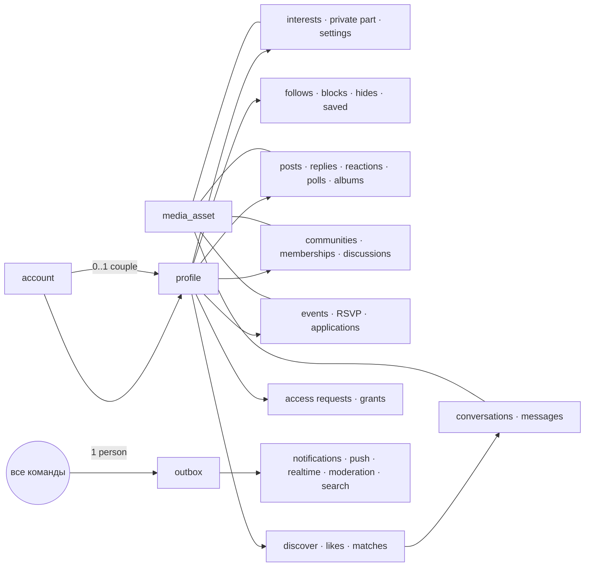

# S1. Доменная модель сервера FetUre

27.10.2026. Источник — прототип V21 (утверждённый UX), решения [V21-PLATFORM-DECISIONS](../design-reference/V21-PLATFORM-DECISIONS.md) и разбор по разделам в [extract/](extract/) (там ссылки на строки прототипа и подробные таблицы полей). Здесь — сводная модель: сущности, владельцы, состояния, инварианты и сквозные правила. Команды — [S2-CATALOG](S2-CATALOG.md), медиа — [S3](S3-MEDIA.md), вопросы владельцу — [OPEN-QUESTIONS](OPEN-QUESTIONS.md).

Статусы реализации: ✅ есть в схеме `feture` (этап 0), ⏳ — следующий срез.

## 0. Принципы

1. **Владелец данных — профиль** (`profile`, вид `person | couple`). У пары два участника-аккаунта. Каждая запись хранит `owner_profile_id` (чьё) и `acted_by_account_id` (кто нажал).
2. **Аккаунт** — только вход, личные настройки, проверка возраста, Premium. Аккаунт владеет одним профилем-человеком и может быть участником не более одной активной пары.
3. **Действующий профиль** приходит с каждым запросом (`X-Fe-Profile`), сервер проверяет членство и состояние пары. «Я» по умолчанию не подставляется.
4. **Пара — отдельный профиль**, а не флаг на человеке: свои интересы, приватная часть, подписки, симпатии, чаты, блокировки, черновики, участие в сообществах и событиях. Новая пара начинается пустой.
5. **Сужение — сразу, расширение — с согласием** (если партнёр его включил). Немедленное сужение у пары отменяет все ожидающие расширения (эпоха безопасности).
6. **Блокировка симметрична по видимости**: если A заблокировал B, они не видят друг друга нигде, в обе стороны. Блок пары распространяется на участников. Принадлежит блок тому профилю, который его поставил.
7. **Счётчики и списки считаются на сервере** из одного источника для действующего профиля. Клиентским числам не верим.
8. **Видимость решает сервер** при сборке DTO. Нет права знать о существовании → `404`, а не `403`.
9. **Откровенное — только в приватных местах** (приватная часть, чаты, `granted`-публикации). В публичных местах — только `safe` (S3).
10. **Ничего точного о месте**: координаты не хранятся — только город или ячейка ≈5 км; расстояния отдаются корзинами по 5 км.
11. **Идентификаторы** — UUID v7; email и ключ Core в доменных таблицах не хранятся.

## 1. Карта областей

## 2. Платформа ✅

| Таблица | Назначение | Ключевые правила |
|---|---|---|
| `account` | Аккаунт FetUre | `state active/suspended/deleting/deleted`; `person_profile_id` (один); `locale` |
| `account_link` | Связь с Core-входом | `HMAC(pepper, core_key)` → `account_id`; email не хранится |
| `profile` | Профиль человека или пары | общий ник `handle` уникален без учёта регистра среди всех профилей; `state active/paused/archived/suspended/deleted`; `safety_epoch`; `rev` |
| `profile_member` | Участники профиля | человек — ровно один; аккаунт — не более одной активной пары; `approves_partner` (каждый участник пары сам решает, одобрять ли изменения партнёра; по умолчанию нет) |
| `partner_approval` | Ожидающие изменения пары | одно ожидающее на (профиль, вид, цель); решает только другой участник; срок 14 дней; `safety_epoch` на момент запроса — устаревшие не применяются |
| `op_ledger` | Идемпотентность | (аккаунт, opId) → результат; повтор с другим входом → 409 |
| `outbox` | Побочные эффекты | пишется в той же транзакции; очередь с повторами и парковкой |
| `media_asset`, `media_attachment`, `media_view`, `media_scan` | Медиа | S3 |

## 3. Аккаунт и вход ⏳

| Сущность | Владелец | Поля (главное) | Правила |
|---|---|---|---|
| Вход (Core) | Core | email-код: 6 цифр, 10 мин, повтор через 30 с, 5 ошибок → новый код; Google/Apple (позже) | «Почта решает»: известная — вход, новая — регистрация |
| `account_settings` | аккаунт | язык, `chat_blur` (по умолчанию да), `show_explicit` (включается **только на сайте**), рассылка новостей | |
| `notification_settings` | аккаунт | режим `safe/normal` (по умолчанию `safe`: без имён и текста на экране блокировки), push/email, дайджест, тихие часы 23:00–08:00 с шагом 30 мин, категории | Уведомления пары приходят каждому участнику по его собственным настройкам |
| `push_device` | аккаунт | токен FCM/APNs, платформа, последняя активность | |
| `age_check` | аккаунт | `none → pending → ok/rejected/expired/revoked`, способ, провайдер (Yoti), действует до | Хранится результат, не документ. Нужен для: запросов к приватной части, откровенных и эфемерных медиа, «Показываюсь» пары (политика — OPEN-QUESTIONS) |
| `u18_event` | система | время, хэш почты/устройства | Регистрация младше 18 → ничего не сохраняем, кроме этого счётчика; повтор → строгая проверка |
| `consent_receipt` | аккаунт | документ, версия, время | Есть на сервере — оставить |
| `data_export_job`, `deletion_job` | аккаунт | состояние, срок | Экспорт — ссылкой на почту; удаление — оркестратор (§13) |

Дата рождения: хранится только для вычисления возраста (на сервере, не отдаётся), либо — по правилу ядра — только «полных лет на дату регистрации» + дата регистрации. Решение — OPEN-QUESTIONS Q20.

## 4. Профиль ⏳

**Общие поля** (`profile` + `profile_details`): `name`, `bio` (Markdown, ≤500), `city_id` или «не показывать», роли/формат/ищу (из справочника, без свободного текста), фото профиля — упорядоченный список ≤6 одобренных публичных медиа (≤1 видео, не первым), аватар = первое фото.

**Только человек:** `handle` (3–20, `[a-z0-9_.]`, начинается и кончается буквой/цифрой, без `..`, есть буква, зарезервированные слова), `show_age`, гендер/ориентация/статус (≤5), `details_vis only|granted|all` (по умолчанию `only` для новых), отметка «Фото подтверждено».

**Только пара:** имя 2–60 (по умолчанию «A и B»), ник — OPEN-QUESTIONS Q9; возраст и гендер участников — из личных профилей, только чтение.

**Настройки видимости профиля** (у каждого профиля свои): `discover_mode visible|hidden|off` (по умолчанию `visible` — решение владельца AUTH-019), `accept_profile_likes` (да), `requests_from all|matches|none` (all), `links_from all|follow|none` (all), `mentions_from all|follow|none` (all), `activity_vis all|followers|off` (all), `show_likes` (да), `private_on` (да, пустая).

**Справочники (система, админка):** `topic` (темы/интересы, категории, скрытые админом), `place` (города; пользователь может добавить город — сразу используется, сотрудник проверяет написание), справочник ролей/форматов/ориентаций.

**Интересы** `interest(profile_id, topic_id)`: `value 1..10` или отметка `discuss` / `hard` (табу), `dir ⊆ {give, get, watch}` (пусто = «всё»; не для категории «границы»), `vis public|granted|only`. Истории интересов нет (владелец, 29.10.2026: экран и таблица `interest_history` удалены). Интересы пары отдельные, не копируются.

**Связи** `profile_link`: вид `partner|play|ds|mentor|meta|friend`, роли сторон (ds, mentor), `pending → ok`, ожидающее изменение, видимость каждой стороны `all|followers|us` (действует самая закрытая), ≤30 на профиль, правило `links_from`, не со своим партнёром/своей парой, не при блоке. Связь на профиле пары — расширение → согласие партнёра (Q16).

## 5. Пара ⏳

| Сущность | Поля | Правила |
|---|---|---|
| `couple_invite` | от аккаунта, кому (по точному нику, без учёта регистра) или токен-ссылка, `pending → accepted/declined/withdrawn/expired` | Не себе, не паре, не тому, кто уже в паре; одно исходящее; блок в любую сторону → отказ; приглашение-ссылка — одноразовый токен с сроком |
| Профиль пары | `state active → paused → active/deleted`; `ended_at`, `restore_until = ended_at + 30 дней`, согласия на восстановление | Разъединение — любым участником сразу. Восстановление — оба в течение 30 дней (знакомства после восстановления выключены). Иначе удаление: профиль и данные пары удаляются, участникам остаётся текстовый архив совместных публикаций |
| `partner_approval` | вид, цель, изменение, слова для сравнения, `pending → approved/returned/cancelled/expired` | §0.5. Вид `private.grant` (открыть приватную часть пары) — **всегда** вдвоём |

**Что происходит при остановке пары:** скрыть из подборки и поиска; отозвать все доступы пары и закрыть запросы; отменить ожидающие согласия; чаты пары — только чтение, медиа недоступны; совместные публикации скрыты; события и сообщества пары — Q17.

## 6. Приватная часть и доступ ⏳

- **Приватная часть** профиля: текст ≤1000, медиа с `purpose=private` (≤12 фото + ≤6 видео), интересы с `vis=granted`. Выключение — одна процедура: отозвать все доступы, закрыть все открытые запросы (с числами в подтверждении); содержимое сохраняется.
- `access_request`: запрашивающий профиль → владелец, области `info | photos | video` (интересы входят в `info`), участники-зрители (снимок аккаунтов), `pending → granted/partial/declined/cancelled/closed`, производное `expired`. Одно ожидающее на пару профилей; повтор после отказа — через 30 дней (Q3); лимит **10 новых запросов в сутки на аккаунт**, общий для «Я» и «Мы»; отмена лимит не возвращает. Запрос не открывает чат и не отправляет симпатию.
- `access_grant`: владелец → зритель, области, срок `без срока | 1 день | 7 дней`, один активный на пару профилей (новый заменяет), сужение на месте, расширение — только новым запросом. Блок отзывает в обе стороны. Действует, только если зритель смотрит от того же профиля, которому выдан.
- Медиа приватной части отдаются с водяным знаком зрителя (на медиа-домене, не клиентом) — S3.

## 7. Социальный граф и личные списки ⏳

| Таблица | Ключ | Правила |
|---|---|---|
| `follow` | (подписчик, цель) — профили | Нельзя на свои профили; уведомление цели; блок удаляет подписки **блокирующего** профиля в обе стороны |
| `note_subscription` | (подписчик, автор) | Подписка только на статьи; автор не узнаёт |
| `block` | (блокирующий профиль, заблокированный профиль) | Разрывает связи, доступы, симпатии, совпадение, подписки, завершает чат — **только для блокирующего профиля**; «И для пары / И для меня» — отдельная команда; разблокировка ничего не восстанавливает; история чата не удаляется (скрывается) |
| `feed_hide` | (профиль, вид `post|author|activity|event`, цель) | Автор не узнаёт; управляется из «Скрытое в ленте» |
| `saved_item` | (профиль, вид `post|event|topic|discussion`, цель) | **По действующему профилю** (Q10); недоступное молча выпадает при чтении |
| `community_mute` | (профиль, сообщество) | Глушит уведомления сообщества |

## 8. Публикации ⏳

- `post`: владелец-профиль, создатель-аккаунт; `type post|note`; заголовок (статья 3–120); текст (пост ≤1000, статья 20–10 000); темы ≤3; медиа ≤6; опрос; снимок ≤4 публичных интересов; `audience all|followers|granted|only`; `in_feed` («не в ленте»); `album_id`; `community_id` (обсуждение в сообществе — тот же пост); `state draft|review|published|removed|archived`; `rev`.
- Правило проверки: **текст без медиа публикуется сразу** (пост-модерация: классификатор + жалобы — Q1). С медиа — `review`, пока все медиа не `approved`. Крупная правка (новое медиа, расширение аудитории, добавлено слов > max(12, 30%)) идёт на проверку, а прежняя версия остаётся видна (`post_revision`); мелкая — сразу. Сохранённые правки (`post_saved_edit`) — черновик правки, видит только владелец.
- `poll_vote` (пост, профиль) — от действующего профиля; результаты видны после своего голоса; переголосовать — сначала отозвать. Правка опроса обнуляет голоса.
- `reaction` (цель `post|reply|discussion`, профиль) — один «лайк»; список лайкнувших не показывает тех, кто скрыл свои лайки, но они в числе.
- `reply`: дерево (в интерфейсе 2 уровня), автор-профиль, ≤1000, публикуется сразу, удаление мягкое («Ответ удалён», если есть ответы), правка своих.
- `mention`: только люди по нику; правило `mentions_from`; запрещённое упоминание остаётся текстом без уведомления; упомянутый может убрать себя.
- `photo_tag`: ≤10 на пост, только люди; пока есть `pending|no` — пост видят только автор и отмеченные; новые фото сбрасывают отметки; «Это я на фото — против» от любого → пост скрыт для всех до решения сотрудника.
- `album`: имя 1–40 уникально у владельца, `vis all|followers`, порядок, обложка; системный альбом фото профиля.
- Ограничения пары: публикация/правка/расширение от пары → согласие (если включено); удалить/скрыть/сузить — сразу.

## 9. Сообщества ⏳

- `community`: владелец-профиль (может быть пара), имя 3–50 уникально, описание 20–500, темы 1–3, `privacy open|closed|hidden`, вопрос при вступлении ≤120, правила, город/онлайн, обложка (только `safe`), `state in_review → published | rejected | hidden`, `rev`. Создание сразу на проверку (без черновиков).
- `community_member`: (сообщество, профиль), роль `owner|host|member`, `state active|left|removed`, `listed` (показывать в списке участников; по умолчанию **нет** — Q13), принятие правил. Удаление — один раз и со статусом; вернуться — только новой заявкой, даже в открытое (бан, Q14).
- `community_join_request`: ответ ≤300 (видят только ведущие), `pending → approved/declined/withdrawn`, `approved → removed`. Решение — ведущие; не свою заявку.
- `community_restriction`: «только чтение»; ведущих ограничить нельзя.
- `community_invite`: токен (хэш), отзыв; без токена скрытое сообщество — 404.
- Обсуждение = `post` с `community_id`: закреплено, исключено из «Популярного» (решают ведущие), удалено ведущим. Читают: открытое — все, закрытое/скрытое — участники. Пара пишет «от пары», если пара — участник (или оба участника — участники без ограничений).

## 10. События ⏳

- `event`: организатор-профиль (может быть пара), сообщество (только если организатор его ведёт), название 5–80, тип, описание 20–1500, `offline|online`, город + район (видят все), **точный адрес / ссылка — только допущенным**, часовой пояс, начало/конец, цена (`free | door | external`), «по заявке» + вопросы, требования ≤500, обложка, фото.
- Состояния: `pending_partner → (returned) → in_review → published → cancelled`; `rejected`, `hidden` (модерация); «прошло» — вычисляется. Одобрение партнёром ведёт на **проверку**, а не в публикацию.
- `event_draft`: частичная форма + шаг, принадлежит профилю, видит владелец.
- `event_rsvp` (событие, профиль): `interested|going|not_going`, `show_in_list` (по умолчанию нет; организатор видит всегда), «билет куплен» (самоотметка). Для событий по заявке — только после одобрения.
- `event_application`: ответы 3–300, заметка, принятие требований, `pending → approved/declined/withdrawn/closed`, одобрение ⇄ отказ. **Ожидающая заявка никогда не считается «идёт».** Допуск = организатор, или одобренная заявка, или `going` (без заявок) — открывает адрес/ссылку.
- `event_announcement` (5–500; автоматическое при изменении времени или места), напоминание за сутки (задача очереди).
- Правка опубликованного события сохраняет ответы, заявки и сообщество; изменение времени/места — объявление участникам; крупная правка — на проверку (Q15).

## 11. Знакомства ⏳

- `discover_filter` (на профиль): показывать людей/пары, возраст 18–99, город или «рядом» (ячейка), радиус 5–100 км, гендер, ориентация, формат, ищу, роли, темы.
- `discover_decision` (профиль, цель): `like|pass`, источник; отмена последнего (1 бесплатно в сутки — Q6, дальше Premium), история (бесплатно — последний, Premium — 7 дней).
- `like` (от профиля к профилю): источник `discover|profile|likes`; правила приёма (`accept_profile_likes`, пары — только через подборку); встречная симпатия → `match`. Отзыв симпатии отзывает и уведомление.
- `match`: один активный на пару профилей; создаёт беседу; завершается «Прекратить общение», блоком, остановкой пары.
- **Подборка (сервер):** кандидат `visible` + одобренное фото + 18+ + без ограничений модерации + нет блока в любую сторону + не свой/не связанный + не решён + проходит фильтр. Зритель — не `off`. Порядок — Q7, без приватных данных.
- «Что у вас общего»: только **публичные** интересы действующего профиля × публичные интересы цели + факт формата отношений. Никогда — приватные, `granted`, табу не публичные, даже при выданном доступе. Без общего балла.

## 12. Чаты ⏳

- `conversation`: два профиля, участники-аккаунты обеих сторон (2–4), создаётся при совпадении, `active → ended` (история остаётся у каждой стороны), пустая беседа показывается как «Новое совпадение».
- `conversation_member`: на **аккаунт**: курсор прочтения `last_read_seq`, без звука, архив (Q19).
- `message`: `seq` (монотонный в беседе), профиль-автор, аккаунт-отправитель, текст ≤2000, ответ на, одно медиа, режим `normal|once|t15|t120|t1440`. Без правки и удаления в V21.
- Эфемерные медиа: обе стороны с подтверждённым 18+; таймер — с первого осознанного открытия; файл удаляется, когда все получатели досмотрели; неоткрытое — максимум 7 дней (Q21).
- Реальное время — только сигнал (S2 §8). Печатает… — сигнал без хранения.

## 13. Уведомления и «Нужно решить» ⏳

- `notification`: получатель-аккаунт, адресат-профиль (метка «Тебе» / «Паре»), тип, кто, объект, прочитано. **Правило рассылки:** событие от других людей паре → обоим участникам; действие участника от имени пары → только партнёру.
- «Нужно решить» — **вычисляемый запрос**, не таблица: приглашения в пару, запросы доступа, согласия партнёра (ожидающие и возвращённые), заявки в сообщества и на события, предложения связей, отметки на фото. Личные пункты участника партнёру не видны. Одно число везде.
- Push: нейтральные тексты (S2 §8); лайки группируются не чаще раза в час; тихие часы — одна утренняя сводка.

## 14. Модерация и сотрудники ⏳ (подробно — S4)

- `report`: цель `profile|post|reply|discussion|community|event|message|media`, причина `threat|private|minor|spam|other` (+ старые коды сопоставить), текст ≤500, снимок цели (делает сервер), «также заблокировать», `open → resolved (removed|kept)`. Одна открытая на (жалобщик, цель); лимиты в сутки. Жалобщик не раскрывается автору.
- Очереди: медиа на проверке, публикации/правки с медиа, сообщества и события до публикации, споры «это я на фото», жалобы (приоритет: `minor` > спор > `threat` > `private` > `spam` > `other`), совпадения CSAM (отдельная закрытая процедура).
- Санкции: ограничение (убрать из подборки и поиска, запретить новые симпатии/запросы/сообщения, отозвать доступы), блокировка аккаунта; апелляции; журнал решений только на добавление.

## 15. Premium и подарки ⏳ (подробно — S8)

`entitlement` (аккаунт, источник `purchase|gift`, период, `renewal_cancelled`), `gift` (от аккаунта, кому — профиль; паре — обоим участникам, цена ×2; анонимно; в очередь, если Premium уже есть). Premium не продвигает и не открывает приватное. Как Premium действует в «Мы» — Q12.

## 16. Удаление и разъединение (сводка)

| Событие | Что происходит |
|---|---|
| Удаление аккаунта | Подтверждение ником; пара разъединяется (партнёр остаётся); профиль-человек и его данные удаляются по срокам хранения (S9); отправленные сообщения остаются у получателей по правилам хранения; сессии отозваны |
| Остановка пары | §5 |
| Удаление пары (через 30 дней) | Профиль пары, интересы, приватная часть, подписки, симпатии — удалены; публикации пары — скрыты, медиа удалены; у каждого участника — текстовый архив |
| Блок | §7 |
| Модерация удалила | Объект `removed`, автор видит пометку; медиа хранится 30 дней для апелляции |

## 17. Что из старого сервера переходит (сводно)

| Старое | Новое |
|---|---|
| `feture_profiles`, `feture_profile_details` | `profile` + детали (типизированные поля вместо свободного текста) |
| `feture_interest_states`, история | `interest` (1–10 + отметки + направление + видимость); истории нет (29.10.2026) |
| `feture_access_requests`, `feture_scoped_grants` | `access_request`, `access_grant` (профили, 3 области, без `can_message`) |
| `feture_blocks` | `block` (профили) |
| `feture_posts` + комментарии, реакции, закладки, жалобы | `post`, `reply`, `reaction`, `saved_item`, `report` |
| `feture_post_photos` + бакет Supabase | `media_asset` (S3) |
| `feture_groups` | `community` (+ участники, заявки — новое) |
| `feture_events`, RSVP, заявки, проверки | `event`, `event_rsvp`, `event_application`, очереди сотрудников |
| документы и согласия, движок проверки возраста, роли сотрудников, журнал модерации | Переносятся почти без изменений (владелец — аккаунт) |
| Тесты, дневник, ссылки-сравнения, публичные псевдонимы авторов, адресные получатели постов | Заморожены / удаляются |
| `feture_profile_access`, `feture_test_responses`, `feture_dating_preferences`, `feture_reports` (старые) | Удаляются |

Перенос данных не нужен: в базе только тестовые и сидовые записи (36 профилей, 76 постов на 27.10.2026). Сиды пересоздаются под новую схему.
