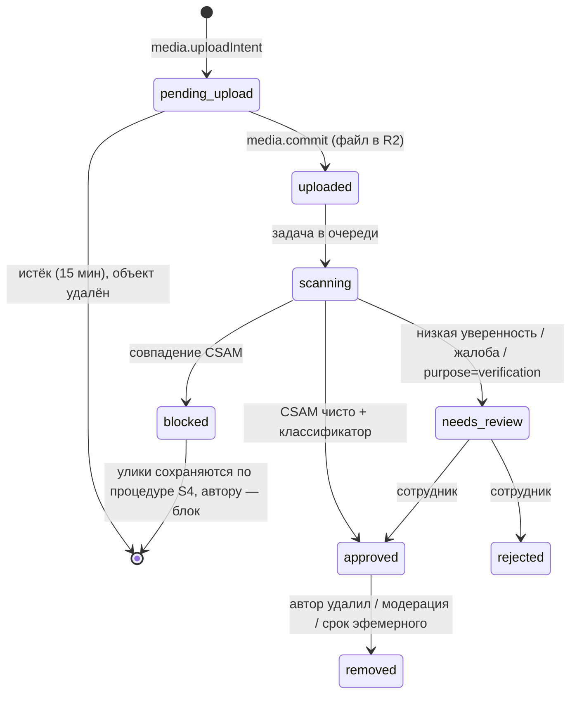

# S3. Медиа: загрузка, проверка, хранение, показ

27.10.2026. Часть серверной спецификации FetUre ([README](README.md)). Решения D4, D5, D8 из [V21-PLATFORM-DECISIONS](../v21/PLATFORM-DECISIONS.md).

## 1. Принципы

1. **Байты медиа никогда не проходят через функции Vercel.** Клиент загружает напрямую в хранилище по одноразовой ссылке. Показ идёт через свой медиа-домен с короткими токенами. API только выдаёт разрешения и хранит метаданные.
2. **Ничего не показывается, пока не проверено.** Каждый файл сначала попадает в карантин. Проверка на CSAM (сверка по хэшам) и классификатор откровенности идут **до** первого показа кому-либо, кроме автора.
3. **Оригинал никому не отдаётся.** Наружу — только варианты, пересобранные без EXIF/GPS и других метаданных.
4. **URL провайдера нигде не хранится и не уходит клиенту.** В базе — ключ объекта. Клиент получает ссылку медиа-домена с токеном на минуты.
5. **Владелец — профиль** («Я» или «Мы»), как у всех данных (S1). Загружает конкретный аккаунт (`acted_by_account_id`).
6. **Метка откровенности обязательна:** `safe | explicit`. В приложениях iOS/Android публичные места показывают только `safe`. `explicit` разрешён в приватной части и чатах — размыт по умолчанию, показ включается на сайте.

## 2а. До публичного запуска (решение владельца 27.10.2026)

Пока всё на Vercel и текущем Supabase, Cloudflare не нужен:

| Задача | Сейчас | После запуска |
|---|---|---|
| Хранение | Supabase Storage, приватный бакет `feture-media` (миграция `20261027120100`) | Cloudflare R2 |
| Загрузка | Подписанная ссылка Supabase на ключ `u/<id>` (перезапись запрещена токеном) | Presigned PUT R2 на `u/<id>` |
| Копии | Обработчик очереди: `sharp` делает `thumb/card/full/blur` (WebP, без EXIF/GPS) из **проверенных** байтов | На лету в Worker (Images binding) |
| Показ | Подписанные ссылки Supabase на копии, 10 мин (одноразовые — 60 с). Не привязаны к зрителю | Токены медиа-домена, привязаны к зрителю |

Переключение — переменные окружения (`R2_*`, `FETURE_MEDIA_TOKEN_SECRET`, `FETURE_MEDIA_ORIGIN`); таблицы и API не меняются (`server/media/delivery.mjs`).

**Ключи.** Клиент получает ссылку только на `u/<id>` (карантин) — его читает только проверка. Показ идёт из `o/<id>` и `v/<id>/<variant>.webp`, которые пишет сервер из тех байтов, что проверил. Подмена файла в карантине после проверки ничего не меняет.

**Известные ограничения до запуска:** ссылки Supabase — «на предъявителя» (кто получил ссылку, может открыть её до истечения срока); одноразовый просмотр не запрещает повтор в пределах 60 с; HEIC переводится в JPEG на устройстве (сервер его не принимает).

## 2. Провайдеры (после запуска)

| Задача | Провайдер | Почему |
|---|---|---|
| Хранение оригиналов и вариантов | Cloudflare R2 (приватный бакет, регион ЕС — jurisdiction `eu`) | Нет платы за исходящий трафик; S3-совместимые presigned URL; adult-контент не запрещён условиями |
| Варианты (размер, формат, кадрирование, размытие) | Cloudflare Images (binding в Worker) | Ресайз и WebP/AVIF на лету, `blur` из коробки, метаданные снимаются |
| Видео | Cloudflare Stream (direct creator upload, signed tokens) | Перекодирование и HLS; токены на воспроизведение |
| Медиа-домен | Cloudflare Worker на `media.<домен>` | Проверяет наш токен, отдаёт вариант из R2/Images; один код для всех типов |
| Проверка CSAM | Hive CSAM Matching API или Thorn Safer Match (выбрать по договору и цене) | Сверка по базам хэшей NCMEC и др. до публикации |
| Классификатор откровенности | Hive Visual Moderation (или аналог) | Ставит метку `explicit`, не блокирует |

Провайдеры спрятаны за интерфейсами `Storage`, `Scanner`, `Classifier`, `VideoHost` в `lib/feture/media/*`. Замена провайдера не должна менять таблицы и API.

> Проверить перед реализацией: цены и условия Hive/Thorn для adult-платформы; ограничения Images binding (`env.IMAGES`) на размер входа; подпись `Content-Length` в presigned PUT R2.

## 3. Сущность `media_asset`

| Поле | Тип | Смысл |
|---|---|---|
| `id` | uuid v7 | |
| `owner_profile_id` | uuid → profile | Владелец («Я» или «Мы») |
| `uploaded_by_account_id` | uuid → account | Кто загрузил |
| `kind` | `image` \| `video` | |
| `purpose` | `post` \| `avatar` \| `private` \| `chat` \| `gallery` \| `community` \| `event` \| `verification` | Куда предназначен; определяет правила видимости и проверки |
| `state` | см. §4 | |
| `explicitness` | `unknown` \| `safe` \| `explicit` | `unknown` до классификатора; автор может поднять до `explicit`, но не опустить классификатор |
| `explicitness_source` | `classifier` \| `author` \| `staff` | |
| `storage_key` | text | Карантинный ключ загрузки `u/<id>`; показываемые копии — `o/<id>`, `v/<id>/*` (выводятся из id) |
| `mime`, `bytes`, `width`, `height`, `duration_ms` | | Из проверки файла, не из заявления клиента |
| `sha256` | bytea | Для дедупликации и повторной сверки |
| `view_rule` | `normal` \| `once` \| `timer` | Для чатов: открыть один раз / на N секунд |
| `view_seconds` | int null | Для `timer` |
| `expires_at` | timestamptz null | Эфемерные медиа удаляются после срока |
| `created_at`, `scanned_at`, `approved_at`, `deleted_at` | | |
| `reject_reason` | text null | Внутреннее: `csam_match`, `invalid_file`, `staff_rejected`, … (пользователю — нейтральный текст) |

Отдельные таблицы:
- `media_attachment(asset_id, target_type, target_id, position)` — где медиа используется (пост, альбом, сообщение, приватная часть, аватар). Один файл может быть в нескольких местах владельца. Видимость определяется местом (S1), а не файлом.
- `media_view(asset_id, viewer_profile_id, viewed_at)` — для `once`/`timer`: повторный показ запрещён.
- `media_scan(asset_id, provider, kind, result, score, raw_ref, created_at)` — журнал проверок (без копий изображений).

## 4. Жизненный цикл

- `approved` — единственное состояние, в котором вариант отдаётся кому-то кроме автора и сотрудников.
- Автор видит свой файл в `uploaded/scanning/needs_review` (превью с пометкой «Проверяем»), чтобы интерфейс V21 не ждал.
- Публикация поста с медиа, которые ещё не `approved`, создаёт пост в состоянии «ждёт проверки медиа»; он появляется в ленте после одобрения всех файлов (как «На проверке» в V21).
- `blocked` (совпадение CSAM): файл недоступен никому, аккаунт автора блокируется, данные сохраняются в изолированном хранилище для передачи по закону (NCMEC CyberTipline / органы ЕС). Процедура — S4.

## 5. Загрузка

1. `media.uploadIntent {purpose, kind, mime, bytes, sha256?, explicit?}` → проверки: действующий профиль и права на `purpose`, лимиты (размер ≤ 20 МБ фото / ≤ 500 МБ видео на MVP, квота в сутки), разрешённые MIME (`image/jpeg, image/png, image/webp, image/heic`, `video/mp4, video/quicktime`). Ответ: `{assetId, upload: {url, method:'PUT', headers}, expiresAt}`.
   - Фото: presigned PUT в R2 на 15 минут с подписанными `Content-Type` и `Content-Length`.
   - Видео: Stream direct creator upload URL (`maxDurationSeconds` по purpose).
2. Клиент загружает файл напрямую (с прогрессом).
3. `media.commit {assetId}` → сервер проверяет, что объект существует и размер совпадает, ставит `uploaded`, пишет задачу `media.scan` в outbox (той же транзакцией).
4. Обработчик очереди: читает оригинал из R2, проверяет реальный тип по сигнатуре, размеры, считает `sha256`; отправляет в Scanner (CSAM), затем в Classifier; пишет `media_scan`; переводит состояние. При `approved` — событие в outbox для зависимых объектов (пост, аватар).

HEIC и большие фото конвертируются в варианты при показе; оригинал хранится как есть, но наружу не выходит.

## 6. Показ

- Клиент никогда не строит URL сам. Любой DTO с медиа содержит `media: {id, w, h, explicit, blurred, src: {thumb, card, full}}`, где `src.*` — ссылки `https://media.<домен>/v/<assetId>/<variant>?t=<token>`.
- Токен — HMAC (секрет общий у API и Worker): `assetId, variant, viewerProfileId, exp` (5–15 минут; для `once` — 60 секунд и одноразовый). Worker проверяет подпись и срок, отдаёт вариант с `Cache-Control: private, max-age=<до exp>`.
- **Варианты:** `thumb` (≈200 px), `card` (≈720 px), `full` (≈1600 px), `blur` (сильное размытие, для «откровенное скрыто»). Видео — HLS через Stream с signed token.
- **Решение «размыть или показать»** принимает сервер при сборке DTO: `explicit` + (клиент — приложение iOS/Android и пользователь не включил показ на сайте, или пользователь включил размытие `chatBlur`) → отдаётся только `blur`, полный вариант — по явному нажатию через `media.reveal {assetId}` (выдаёт токен на `full`, пишет `media_view` для `once/timer`).
- Платформа клиента берётся из подписанного заголовка сессии (тип устройства при входе Core), а не из параметра запроса.
- Публичные места (лента, публичный профиль, сообщества, события, подборка) в приложениях **не отдают `explicit` вообще** — даже размытым. На сайте `explicit` в публичных местах тоже запрещён правилами сообщества; классификатор отправляет такой пост на проверку.

## 7. Удаление и сроки

| Случай | Что происходит |
|---|---|
| Автор удалил медиа | `removed`, токены перестают выдаваться сразу; объект в R2 удаляется задачей через 24 ч (окно для отмены удаления в V21) |
| Эфемерное медиа просмотрено / истёк срок | Объект удаляется задачей сразу после окна просмотра |
| Удаление аккаунта / профиля пары | Все медиа профиля — в очередь на удаление (S9); общие медиа пары — по правилам разъединения (30 дней восстановления, затем архив только для чтения без медиа другого участника) |
| `pending_upload` не подтверждён | Удаляется через 15 минут |
| Модерация удалила | `removed`, причина в журнале модерации; оригинал хранится 30 дней для апелляции, затем удаляется |

## 8. Аватар и проверка фото

- Аватар — `media_asset` с `purpose=avatar`, только `safe`. Без одобренного аватара профиль не показывается в подборке (решение владельца AUTH-019).
- «Проверка фото» (V21 `photoCheck`) — отдельный `purpose=verification`, всегда `needs_review` у сотрудника, никогда не показывается другим пользователям; хранится до решения + 30 дней.

## 9. Что меняется в текущем коде

| Сейчас | Станет |
|---|---|
| `photo.put` принимает JPEG base64 в теле запроса ≤ 512 КБ, `sharp` пересобирает в функции | `media.uploadIntent` + прямая загрузка + `media.commit`; `sharp` в функции не нужен |
| Бакет Supabase Storage `feture-post-photos`, байты отдаются через API (`photo.read`) | R2 + медиа-домен; `photo.read` удаляется |
| Согласие на проверку фото сотрудником (`post-photo-consent`), `staff-photo-read` | Сохраняются как правила S4; чтение сотрудником — тоже через токен медиа-домена, с записью в журнал доступа |
| Нет метки откровенности и CSAM-проверки | Обязательны до показа |

## 10. Проверки (тесты, которые обязаны быть)

- Токен: чужой `viewerProfileId`, просроченный, другой вариант, подделанная подпись → 403.
- `explicit` не попадает в DTO публичных мест для клиента-приложения; попадает размытым в чат/приватную часть.
- Медиа в `scanning/needs_review` видит только автор и сотрудник.
- `once`: второй `media.reveal` того же зрителя → отказ.
- Совпадение CSAM: пост не публикуется, аккаунт блокирован, медиа недоступно никому, создан кейс S4.
- Presigned URL нельзя использовать для другого ключа или большего размера.
